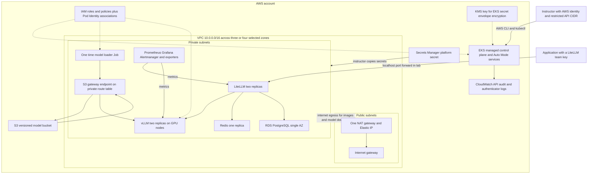

# Astra advanced AWS CLI infrastructure supplement

This advanced supplement builds the AWS infrastructure behind Astra in `week08`, one explained AWS CLI command block at a time. For the requested Console ClickOps route or the existing Terraform route, start with [the infrastructure guide](manual-infrastructure-guide.md). It is the manual companion to [the existing deployment guide](deployment-guide.md). It also carries the resulting AWS identifiers into the existing Kubernetes manifests so the class can finish with a working inference API. Run the blocks individually, stopping at each checkpoint; do not run the whole document as a script.

The baseline is EKS Auto Mode, two GPU model-server replicas, LiteLLM, Redis, RDS PostgreSQL, S3 model storage, Secrets Manager, and Prometheus/Grafana monitoring. The installed Terraform module defaults also create CloudWatch logging, a KMS key, an IAM OIDC provider, and additional security groups. All of these are included below. No Terraform, CloudFormation, or eksctl scaffolding is used.

**Validation boundary:** prepared on 17 October 2026 from the local source, installed module code, and official documentation. Commands were reviewed and statically checked; this manual build was not deployed or live-tested. The earlier deployment guide's claim of a successful Terraform build is its own historical evidence, not evidence that these replacement CLI commands have run.

## Three inference delivery routes

| Route | Who hosts and operates inference | Decision relevant to Astra |
|---|---|---|
| **Direct model-provider API** | The model company operates its API and serving infrastructure; your application calls that company directly. | Fast access to the provider's models, with its pricing, availability, data terms, and API lifecycle. You do not operate its GPU fleet. |
| **Cloud-provider managed access** | A cloud service operates the serving layer, such as Amazon Bedrock, Microsoft Foundry Models on Azure, or Gemini API in Google Cloud Vertex AI. | Integrates model access with cloud identity, procurement, regions, and service controls. Available models and deployment types vary. |
| **Self-hosting** | Your organization selects the weights and operates the serving application and capacity. In this lab AWS still manages EKS and Auto Mode infrastructure. | You control the model artifact, serving settings, rollout, and gateway, while owning capacity planning, compatibility, reliability, and operating cost. |

These are delivery routes, not model-quality tiers. The same model family can be available through more than one route. Calling an API does not reveal who operates the GPUs. An SDK chat-model wrapper changes how application code calls an endpoint; it is not a fourth hosting architecture. The cloud examples refer to inference services, not packaged enterprise chat applications. See [Bedrock inference](https://docs.aws.amazon.com/en_en/bedrock/latest/userguide/inference-api.html), [Microsoft Foundry Models](https://learn.microsoft.com/en-us/azure/foundry/concepts/foundry-models-overview), and [Gemini API in Vertex AI](https://docs.cloud.google.com/vertex-ai/generative-ai/docs/start/quickstart).

This lab uses self-hosting so students operate the model delivery path: promote weights, provision GPUs, tune serving, enforce team access, observe requests, and remove resources. EKS makes those workloads schedulable and replaceable across zones; Auto Mode reduces node/driver administration while leaving the infrastructure and IAM relationships visible. This is not a claim that self-hosting is always cheaper or more capable. Low utilization, on-call work, and capacity shortages can make managed access the better operational choice.

## Model selection

Use the [dated adoption evidence, exact-model comparison, and workload-first evaluation process](deployment-guide.md#5-model-adoption-capabilities-and-selection) in the deployment guide. It includes Kimi K3's official downloadable checkpoint and distributed deployment implications. Qwen3.8-27B-FP8 remains the implemented lab candidate; one-GPU fit and download counts do not establish a production winner.

## The inference concepts used in this lab

The model weights are the learned parameters loaded for inference. This lab runs existing weights to generate tokens; it does not train or fine-tune them. A prompt's prefill stage processes input tokens, then decoding generates output tokens progressively. The KV cache retains attention state for active sequences. Longer prompts and more concurrent sequences consume more memory and can increase waiting time even when the weights fit.

| Lab component or resource | Responsibility and reason for this design |
|---|---|
| CPU nodes | Run the loader, LiteLLM, Redis, and monitoring. They handle downloads, request validation, accounting, and orchestration without consuming scarce GPU capacity. CPU and host RAM on GPU nodes also support tokenization, file copying, and the serving process. |
| GPU and VRAM | Perform the model's numerical inference and hold weights/cache. Kubernetes `nvidia.com/gpu: 1` allocates a device; it does not add GPU memory to the pod's ordinary RAM limit. Two replicas each load the model independently. |
| vLLM serving engine | Loads the artifact, batches requests, manages model execution/cache, and exposes an OpenAI-compatible API. It is not the model itself. Its context/concurrency settings trade throughput and latency against memory. |
| LiteLLM gateway | Gives applications the stable name `astra`, checks virtual keys, applies budgets/rate limits, records spend, and calls the backend. It separates team policy from model execution. |
| Redis and RDS | Redis coordinates fast counters between gateway replicas; RDS retains teams, keys, and spend. A volatile counter store and a durable database solve different problems. |
| S3 and node storage | S3 retains the promoted model version. Node `emptyDir` holds a disposable serving copy; EBS-backed Prometheus storage retains metrics across pod restarts. RDS has its own managed storage. |
| VPC routing and access controls | Private subnets host nodes/pods/database; NAT permits external downloads; the S3 endpoint bypasses NAT for regional model storage traffic. SGs constrain AWS network paths; NetworkPolicy prevents ordinary pods from bypassing the gateway. |
| IAM and Kubernetes access | Cluster/node roles let AWS operate infrastructure. Pod Identity gives loader/serving pods distinct bucket permissions. An instructor access entry authorizes cluster administration. Team API keys authorize inference clients. These identities are not interchangeable. |
| Prometheus and Grafana | Observe queueing, token throughput, time to first token, replica availability, and internal spend. GPU utilization alone cannot tell whether users receive timely answers. Langfuse request tracing is outside this baseline. |

**Teaching checkpoint:** ask which layer would change for a new model, a new team, an extra replica, or a different monthly budget. The goal is to understand these boundaries before executing the corresponding creation commands.

## How to teach this guide

Before each block, explain the purpose, name the inputs it depends on, and ask students to predict the result. Execute it only after that discussion. Stop on an error; do not continue with an empty resource ID. AWS creation calls are generally not safe to repeat blindly. If a call times out, use its corresponding describe/list operation to find whether it succeeded before trying again.

Suggested sessions are networking and IAM, EKS and data services, then serving and operations. The first two sessions can be taught without launching GPU workloads. EKS, NAT, RDS, and other resources still incur costs during those sessions.

**Execution environment:** Bash with AWS CLI, kubectl, Helm, jq, Python 3, and OpenSSL. The Windows path is shown through WSL; adjust the course path on Linux or macOS. This guide assumes Linux and CLI fluency and explains the architectural effects of the blocks.

## Architecture and accurate counts



The arrows to the private subnet group describe network paths, not Kubernetes objects. RDS is an AWS-managed database, not a PostgreSQL pod. EKS runs the control plane in an AWS-managed account and attaches network interfaces in the selected customer subnets. Choosing three control-plane subnets does not mean manually deploying three API-server pods.

| Counting unit | Baseline count | Meaning |
|---|---:|---|
| AWS service families configured by the source and active module defaults | **9** | VPC, EC2 including EBS, EKS, IAM, S3, RDS, Secrets Manager, KMS, CloudWatch Logs. STS is an identity API used by IAM workflows, not an extra deployed application. |
| Terraform-managed instances in the historical four-zone backup | **82** | 76 AWS resources or configuration/association objects, 5 local random passwords, and 1 local wait. This is a historical state count, not a current AWS inventory. |
| General source count with A selected zones | **66 + 4A** | 20 root instances, 33 EKS module instances, 2 KMS module instances, and 11 + 4A VPC module instances. This manual uses A = 3 or 4. |
| Authored Kubernetes objects in `k8s/*.yaml` | **24** | 6 platform, 2 GPU scheduling, 1 loader Job, 7 serving, 7 gateway/Redis, and 1 dashboard. The monitoring values file is chart input, not another Kubernetes object. |
| Kubernetes Secrets created by the source script | **3** | Model API key, gateway environment, Grafana admin credentials. |
| Long-running application and monitoring functions | **9** | vLLM, LiteLLM, Redis, Prometheus Operator, Prometheus, Grafana, Alertmanager, kube-state-metrics, node-exporter. There is also 1 transient model-loader function. Replica and DaemonSet pod counts vary. |

Do not add 9, 82, and 24 together. They count different layers. The 82 includes bucket settings, rules, policy attachments, route associations, and adopted VPC defaults; it is not 82 servers. It excludes EKS-created primary security groups, service-linked roles, ENIs, Auto Mode EC2 instances, instance profiles, and dynamically provisioned EBS volumes. Those service-managed resources have changing counts. Helm also expands into many additional objects; render the chosen chart to count them.

Auto Mode manages node provisioning, networking and service routing, local cluster DNS, Pod Identity delivery, EBS integration, NVIDIA drivers, and the GPU device plugin. The GPU plugin need not appear as a DaemonSet. Do not install another Karpenter, VPC CNI, GPU Operator, NVIDIA device plugin, EBS CSI driver, or Pod Identity Agent over these managed components. See [Auto Mode responsibilities](https://docs.aws.amazon.com/eks/latest/userguide/automode.html) and [accelerated workloads](https://docs.aws.amazon.com/eks/latest/userguide/auto-accelerated.html).

**Different variant:** `../eks-gpu-self-hosted` is the larger platform with Argo CD, Open WebUI, Langfuse and its databases, External Secrets, KEDA, Cognito, Bedrock guardrails/fallback, and DNS/TLS/Ingress. These are not in Astra/week08 Terraform or manifests. Astra uses ClusterIP services and local port forwarding. No ALB/NLB, Route 53 zone, ACM certificate, private ECR repository, ElastiCache cluster, or chat UI is a mandatory creation here. Auto Mode IAM permissions for load balancing do not themselves create a load balancer. The model publisher and public container registries are external download dependencies.

## Source fidelity and deliberate choices

The audit used every file in `week08/terraform`, VPC module **6.7.3**, EKS module **21.29.0**, and KMS module **4.0.0** from `.terraform/modules/modules.json`. Version constraints such as `~> 21.29` permit later patch/minor releases within that major version; this guide follows the installed versions, not every possible future resolution. The backup state's resource addresses and counts were checked without copying secret values into this guide.

The commands preserve the configuration with these disclosed operational choices:

- Names are predictable within a dedicated lab instead of Terraform-generated suffixes. Use a fresh `CLUSTER` and bucket suffix for each lab. Do not point this guide at an existing deployment.
- `ManagedBy=manual` accurately identifies CLI-created resources; Terraform uses `ManagedBy=terraform`. Project and Environment tags are retained. Automatically created resources receive service tags and, where configured, the GPU `Workload` tag; AWS CLI has no provider-wide default tag mechanism.
- The source's GPU-zone check accepts two zones, but `slice(private_subnets, 0, 3)` requires at least three. This guide requires three before creation, then uses up to four as the source intends. A two-zone redesign requires an explicit change to that expression and is outside this exact build.
- The installed EKS module attaches the legacy `AmazonEKSBlockStoragePolicy`. Current AWS instructions recommend V2. The exact-source path below preserves the legacy attachment and documents the V2 migration checkpoint rather than silently changing it.
- The unused module-created node security group and IAM OIDC provider are included for Terraform coverage. Astra's GPU NodeClass actually selects the **EKS primary security group**, and its S3 workload roles use **Pod Identity**, not IRSA.
- `_PROMOTED` marks upload completion; it is not a cryptographic model integrity check. Model revision, license, tokenizer compatibility, and image pins still need instructor review.

## 1 Prepare the workstation and record the lab identity

**Explain before running:** these local commands select the dedicated course directory, create private working directories, and define a small identifier recorder. They create no cloud resources. `remember` exports a non-secret value and saves a safely quoted assignment for recovery. Never use it for passwords or API keys. `umask 077` restricts files created later. Expected result: tools print versions and the working directory is the week08 folder.

```bash
cd /mnt/c/Users/kserg/Desktop/llm-ops/llmops-course/week08
set -euo pipefail
set +x
umask 077
export AWS_PAGER=""
export LAB_DIR="$HOME/astra-manual-lab"
mkdir -p "$LAB_DIR/private" "$LAB_DIR/manifests"
chmod 700 "$LAB_DIR" "$LAB_DIR/private"
export LEDGER="$LAB_DIR/resource-ids.env"
touch "$LEDGER"
chmod 600 "$LEDGER"
remember() {
  local name="$1" value="$2"
  [[ "$name" =~ ^[A-Z][A-Z0-9_]*$ && -n "$value" && "$value" != None ]]
  export "$name=$value"
  printf 'export %s=%q\n' "$name" "$value" >> "$LEDGER"
}
aws --version
kubectl version --client
helm version --short
jq --version
python3 --version
```

Use a current AWS CLI v2 supporting the Auto Mode fields below, kubectl within one minor version of EKS, and a Helm release compatible with the chosen chart. Python 3 and jq handle JSON locally. OpenSSL is used only for random non-secret bucket suffixes. The active identity needs the creation, inspection, tagging, IAM PassRole, service-linked-role creation, EKS access management, and deletion permissions used below. Organization SCPs and permissions boundaries may further restrict it. Use your normal SSO/assumed-role session; do not create long-lived IAM access keys for this class.

**Explain before running:** set safe placeholders for the AWS profile and the instructor's stable IAM user or role ARN. An STS `assumed-role/.../session` ARN is not an EKS access-entry principal; use the underlying IAM role ARN, including its path. The CIDR must be your real egress IP with `/32`, not the documentation example. The identity lookup is read-only. Expected result: the displayed account and caller match the intended lab account.

```bash
remember AWS_PROFILE 'YOUR_LAB_PROFILE'
remember AWS_REGION 'us-east-1'
remember ENVIRONMENT 'lab'
remember CLUSTER 'astra-lab'
remember ADMIN_PRINCIPAL_ARN 'arn:aws:iam::123456789012:role/YOUR_LAB_ROLE'
remember ADMIN_CIDR '203.0.113.7/32'
# If this profile uses IAM Identity Center, authenticate first:
aws sso login --profile "$AWS_PROFILE"
aws sts get-caller-identity
remember ACCOUNT_ID "$(aws sts get-caller-identity --query Account --output text)"
remember CLUSTER_ROLE "$CLUSTER-cluster"
remember NODE_ROLE "$CLUSTER-eks-auto"
remember DB_ID "$CLUSTER-gateway"
remember SECRET_NAME "$CLUSTER/platform-manual"
export TAGS="Project=astra,Environment=$ENVIRONMENT,ManagedBy=manual"
```

For a profile that already has another valid credential source, omit only `aws sso login`. Resolve placeholders before continuing. The commands assume the commercial `aws` partition, matching `us-east-1`. Do not substitute GovCloud or China without adjusting ARNs, service endpoints, and availability checks.

## 2 Check versions GPU availability quotas and cost

**Explain before running:** EKS versions and instance offerings are account/region lookups, not resource creations. Save the catalog, choose a standard-support EKS version, and find the first four sorted zones that offer `g6e.xlarge`, reproducing the source's discovery logic. The source pins Kubernetes `1.36`; accept it only if the live catalog supports it. Expected result: three or four selected zones and an explicit compatible version. An offering is not a capacity reservation.

```bash
aws eks describe-cluster-versions > "$LAB_DIR/eks-versions.json"
jq '.clusterVersions[] | {clusterVersion,versionStatus}' \
  "$LAB_DIR/eks-versions.json"
remember K8S_VERSION '1.36'
jq -e --arg v "$K8S_VERSION" \
  '.clusterVersions[] | select(.clusterVersion==$v and
   .versionStatus=="STANDARD_SUPPORT")' "$LAB_DIR/eks-versions.json"
aws ec2 describe-instance-type-offerings \
  --location-type availability-zone \
  --filters Name=instance-type,Values=g6e.xlarge \
  > "$LAB_DIR/gpu-offerings.json"
jq -r '[.InstanceTypeOfferings[].Location] | unique | sort | .[:4][]' \
  "$LAB_DIR/gpu-offerings.json" > "$LAB_DIR/zones.txt"
mapfile -t AZS < "$LAB_DIR/zones.txt"
(( ${#AZS[@]} >= 3 ))
printf '%s\n' "${AZS[@]}"
aws ec2 describe-instance-types \
  --instance-types g6e.xlarge g6e.2xlarge g6e.4xlarge \
  --query 'InstanceTypes[].{Type:InstanceType,vCPU:VCpuInfo.DefaultVCpus,MemoryMiB:MemoryInfo.SizeInMiB,GPU:GpuInfo}'
```

If `1.36` fails the standard-support check, stop and select an available version only after verifying Auto Mode and chart compatibility. Record that deviation. Check [EKS version discovery](https://docs.aws.amazon.com/eks/latest/APIReference/API_DescribeClusterVersions.html) and [instance offerings](https://docs.aws.amazon.com/cli/latest/reference/ec2/describe-instance-type-offerings.html). The source's one-L40S choices use 4, 8, and 16 vCPUs respectively. A three-node rolling-update allowance can therefore require up to **48 G/VT On-Demand vCPUs**, plus other running GPU instances; two smallest nodes need 8. CPU workloads use a separate quota category.

**Explain before running:** these read-only calls check the G/VT On-Demand quota, CPU-instance quota, and whether the desired PostgreSQL major version is orderable on the source's DB size. Expected result: sufficient quota and at least one compatible PostgreSQL 17 minor version. Quota approval does not guarantee stock in a particular zone.

```bash
aws service-quotas get-service-quota --service-code ec2 \
  --quota-code L-DB2E81BA --query 'Quota.{Name:QuotaName,Value:Value}'
aws service-quotas get-service-quota --service-code ec2 \
  --quota-code L-1216C47A --query 'Quota.{Name:QuotaName,Value:Value}'
aws rds describe-orderable-db-instance-options --engine postgres \
  --db-instance-class db.t4g.small --query \
  'OrderableDBInstanceOptions[].{Version:EngineVersion,Storage:StorageType}'
aws rds describe-db-engine-versions --engine postgres \
  --query 'DBEngineVersions[?starts_with(EngineVersion, `17.`)].EngineVersion'
remember PG_VERSION 'REPLACE_WITH_ORDERABLE_17_MINOR'
```

**Cost checkpoint:** before creating the VPC, estimate the session and overnight cost in the [AWS Pricing Calculator](https://calculator.aws/). Include EKS cluster fee and Auto Mode surcharge, two GPU instances plus a possible third during updates, CPU nodes, node EBS disks, the 20 GiB Prometheus volume, RDS compute and storage/backups, NAT hourly and data processing, public IPv4, S3 storage/requests/versions, Secrets Manager, KMS, and CloudWatch ingestion/retention. Check [EKS pricing](https://aws.amazon.com/eks/pricing/) and [EC2 On-Demand pricing](https://aws.amazon.com/ec2/pricing/on-demand/). The old `$4.45/hour` source estimate is not a current quote or cap. NodePool GPU limits are not an AWS spending limit; NAT and RDS continue charging when GPU pods are gone. Assign an instructor to cleanup and set a session end time.

**Instructor prompt:** why does an unused gateway still cost money? Why can a region offer a GPU while an actual launch fails?

## 3 Create the VPC and adopt its default objects

**Explain before running:** create the isolated `10.0.0.0/16` network and enable AWS DNS resolution and hostnames. The tagging helper attaches the same project/environment metadata throughout EC2/VPC operations. Dependencies: completed account, version, quota, and cost checks. Expected result: one available VPC, with both DNS attributes enabled.

```bash
ec2tag() {
  local id="$1" name="$2"
  aws ec2 create-tags --resources "$id" --tags \
    Key=Name,Value="$name" Key=Project,Value=astra \
    Key=Environment,Value="$ENVIRONMENT" Key=ManagedBy,Value=manual
}
remember VPC_ID "$(aws ec2 create-vpc --cidr-block 10.0.0.0/16 \
  --instance-tenancy default --query Vpc.VpcId --output text)"
aws ec2 wait vpc-available --vpc-ids "$VPC_ID"
ec2tag "$VPC_ID" "$CLUSTER"
aws ec2 modify-vpc-attribute --vpc-id "$VPC_ID" --enable-dns-support
aws ec2 modify-vpc-attribute --vpc-id "$VPC_ID" --enable-dns-hostnames
aws ec2 describe-vpc-attribute --vpc-id "$VPC_ID" --attribute enableDnsSupport
aws ec2 describe-vpc-attribute --vpc-id "$VPC_ID" --attribute enableDnsHostnames
```

**Explain before running:** AWS automatically creates a main route table, a default network ACL, and a default security group with a VPC. The VPC module adopts all three. We identify and tag them, remove default security-group permissions, and retain the module's allow-all ACL rules. This modifies only the new lab VPC. Default ACLs are stateless; security groups are stateful. The main route table retains only the automatic local route. Expected result: the default SG has no ingress or egress rules; default ACL rules 100 and 101 allow IPv4/IPv6, followed by implicit deny. IPv6 is not enabled on this VPC.

```bash
remember DEFAULT_RT "$(aws ec2 describe-route-tables --filters \
  Name=vpc-id,Values="$VPC_ID" Name=association.main,Values=true \
  --query 'RouteTables[0].RouteTableId' --output text)"
remember DEFAULT_ACL "$(aws ec2 describe-network-acls --filters \
  Name=vpc-id,Values="$VPC_ID" Name=default,Values=true \
  --query 'NetworkAcls[0].NetworkAclId' --output text)"
remember DEFAULT_SG "$(aws ec2 describe-security-groups --filters \
  Name=vpc-id,Values="$VPC_ID" Name=group-name,Values=default \
  --query 'SecurityGroups[0].GroupId' --output text)"
ec2tag "$DEFAULT_RT" "$CLUSTER-default"
ec2tag "$DEFAULT_ACL" "$CLUSTER-default"
ec2tag "$DEFAULT_SG" "$CLUSTER-default"
aws ec2 describe-security-groups --group-ids "$DEFAULT_SG" \
  > "$LAB_DIR/default-sg.json"
jq '.SecurityGroups[0].IpPermissions' "$LAB_DIR/default-sg.json" \
  > "$LAB_DIR/default-ingress.json"
jq '.SecurityGroups[0].IpPermissionsEgress' "$LAB_DIR/default-sg.json" \
  > "$LAB_DIR/default-egress.json"
aws ec2 revoke-security-group-ingress --group-id "$DEFAULT_SG" \
  --ip-permissions "file://$LAB_DIR/default-ingress.json"
aws ec2 revoke-security-group-egress --group-id "$DEFAULT_SG" \
  --ip-permissions "file://$LAB_DIR/default-egress.json"
for direction in ingress egress; do
  flag=--no-egress
  [[ "$direction" == egress ]] && flag=--egress
  aws ec2 replace-network-acl-entry --network-acl-id "$DEFAULT_ACL" \
    "$flag" --rule-number 100 --protocol -1 --rule-action allow \
    --cidr-block 0.0.0.0/0
  aws ec2 create-network-acl-entry --network-acl-id "$DEFAULT_ACL" \
    "$flag" --rule-number 101 --protocol -1 --rule-action allow \
    --ipv6-cidr-block ::/0
done
aws ec2 describe-security-groups --group-ids "$DEFAULT_SG"
aws ec2 describe-network-acls --network-acl-ids "$DEFAULT_ACL"
```

On a newly created IPv4-only VPC, rule 101 is normally absent. If the describe output already has 101, use `replace-network-acl-entry` for that rule instead of `create`. Do not delete implicit `*` deny entries. No custom DHCP options, VPN, IPv6 allocation, flow logs, or dedicated subnet ACLs are enabled by this source.

## 4 Create subnets and route internet egress

**Explain before running:** each chosen zone receives a private `/20` and public `/24`. Private CIDRs are `10.0.0.0/20`, `10.0.16.0/20`, `10.0.32.0/20`, and optionally `10.0.48.0/20`; public CIDRs are `10.0.240.0/24` onward. Public means a route to an internet gateway, not automatic public IP assignment. The `astra/cluster` private-subnet tag is the GPU NodeClass discovery contract. Expected result: two subnets per selected zone, all with public-IP auto-assignment disabled.

```bash
: > "$LAB_DIR/private-subnets.txt"
: > "$LAB_DIR/public-subnets.txt"
for i in "${!AZS[@]}"; do
  private=$(aws ec2 create-subnet --vpc-id "$VPC_ID" \
    --availability-zone "${AZS[$i]}" --cidr-block "10.0.$((i*16)).0/20" \
    --query Subnet.SubnetId --output text)
  printf '%s\n' "$private" >> "$LAB_DIR/private-subnets.txt"
  ec2tag "$private" "$CLUSTER-private-${AZS[$i]}"
  aws ec2 create-tags --resources "$private" --tags \
    Key=kubernetes.io/role/internal-elb,Value=1 Key=astra/cluster,Value="$CLUSTER"
  public=$(aws ec2 create-subnet --vpc-id "$VPC_ID" \
    --availability-zone "${AZS[$i]}" --cidr-block "10.0.$((240+i)).0/24" \
    --query Subnet.SubnetId --output text)
  printf '%s\n' "$public" >> "$LAB_DIR/public-subnets.txt"
  ec2tag "$public" "$CLUSTER-public-${AZS[$i]}"
  aws ec2 create-tags --resources "$public" --tags Key=kubernetes.io/role/elb,Value=1
  aws ec2 modify-subnet-attribute --subnet-id "$private" --no-map-public-ip-on-launch
  aws ec2 modify-subnet-attribute --subnet-id "$public" --no-map-public-ip-on-launch
done
mapfile -t PRIVATE_SUBNETS < "$LAB_DIR/private-subnets.txt"
mapfile -t PUBLIC_SUBNETS < "$LAB_DIR/public-subnets.txt"
aws ec2 describe-subnets --filters Name=vpc-id,Values="$VPC_ID" \
  --query 'Subnets[].{ID:SubnetId,AZ:AvailabilityZone,CIDR:CidrBlock,PublicIP:MapPublicIpOnLaunch}'
```

**Explain before running:** the internet gateway is attached to the VPC. A dedicated public route table points `0.0.0.0/0` to it and is associated with all public subnets. The VPC's local route remains automatic. These route associations are separate Terraform-managed objects. Expected result: one public route table with a working default route and one association per public subnet.

```bash
remember IGW_ID "$(aws ec2 create-internet-gateway \
  --query InternetGateway.InternetGatewayId --output text)"
ec2tag "$IGW_ID" "$CLUSTER"
aws ec2 attach-internet-gateway --internet-gateway-id "$IGW_ID" --vpc-id "$VPC_ID"
remember PUBLIC_RT "$(aws ec2 create-route-table --vpc-id "$VPC_ID" \
  --query RouteTable.RouteTableId --output text)"
ec2tag "$PUBLIC_RT" "$CLUSTER-public"
aws ec2 create-route --route-table-id "$PUBLIC_RT" \
  --destination-cidr-block 0.0.0.0/0 --gateway-id "$IGW_ID"
: > "$LAB_DIR/route-associations.txt"
for subnet in "${PUBLIC_SUBNETS[@]}"; do
  aws ec2 associate-route-table --route-table-id "$PUBLIC_RT" \
    --subnet-id "$subnet" --query AssociationId --output text \
    >> "$LAB_DIR/route-associations.txt"
done
```

**Explain before running:** a NAT gateway in the first public subnet lets private nodes reach public registries and Hugging Face. It uses one Elastic IP. All private subnets share one private route table and this NAT, matching `single_nat_gateway=true`. This is a single-zone egress dependency with possible cross-zone charges. Expected result: NAT `available`, a private default route to it, and one private association per zone.

```bash
remember EIP_ID "$(aws ec2 allocate-address --domain vpc \
  --query AllocationId --output text)"
ec2tag "$EIP_ID" "$CLUSTER-${AZS[0]}"
remember NAT_ID "$(aws ec2 create-nat-gateway --subnet-id "${PUBLIC_SUBNETS[0]}" \
  --allocation-id "$EIP_ID" --connectivity-type public \
  --query NatGateway.NatGatewayId --output text)"
ec2tag "$NAT_ID" "$CLUSTER-${AZS[0]}"
aws ec2 wait nat-gateway-available --nat-gateway-ids "$NAT_ID"
remember PRIVATE_RT "$(aws ec2 create-route-table --vpc-id "$VPC_ID" \
  --query RouteTable.RouteTableId --output text)"
ec2tag "$PRIVATE_RT" "$CLUSTER-private"
aws ec2 create-route --route-table-id "$PRIVATE_RT" \
  --destination-cidr-block 0.0.0.0/0 --nat-gateway-id "$NAT_ID"
for subnet in "${PRIVATE_SUBNETS[@]}"; do
  aws ec2 associate-route-table --route-table-id "$PRIVATE_RT" \
    --subnet-id "$subnet" --query AssociationId --output text \
    >> "$LAB_DIR/route-associations.txt"
done
aws ec2 describe-route-tables --route-table-ids "$PUBLIC_RT" "$PRIVATE_RT"
```

## 5 Create the S3 gateway endpoint and model bucket

**Explain before running:** the gateway endpoint adds an S3 prefix-list route to the private route table so regional model downloads from S3 bypass NAT. It has no interface endpoint ENIs or security group. The default endpoint policy permits access; IAM still restricts each workload. Dependencies: VPC and private route table. Expected result: endpoint `available` and a new S3 route. See [gateway endpoint API](https://docs.aws.amazon.com/cli/latest/reference/ec2/create-vpc-endpoint.html).

```bash
remember S3_ENDPOINT_ID "$(aws ec2 create-vpc-endpoint --vpc-id "$VPC_ID" \
  --vpc-endpoint-type Gateway --service-name "com.amazonaws.$AWS_REGION.s3" \
  --route-table-ids "$PRIVATE_RT" --query VpcEndpoint.VpcEndpointId --output text)"
ec2tag "$S3_ENDPOINT_ID" "$CLUSTER-s3"
aws ec2 describe-vpc-endpoints --vpc-endpoint-ids "$S3_ENDPOINT_ID" \
  --query 'VpcEndpoints[].{ID:VpcEndpointId,State:State,Routes:RouteTableIds}'
```

**Explain before running:** create a globally unique private model bucket, block all public-access mechanisms, and enable versioning. These are three managed Terraform instances on the same bucket. The source relies on S3's default server-side encryption, not its EKS KMS key. Versioning preserves older weights and also means cleanup must delete object versions. Expected result: all four public-access flags true and versioning `Enabled`.

```bash
remember BUCKET "$CLUSTER-models-$ACCOUNT_ID-$(openssl rand -hex 4)"
if [[ "$AWS_REGION" == us-east-1 ]]; then
  aws s3api create-bucket --bucket "$BUCKET"
else
  aws s3api create-bucket --bucket "$BUCKET" \
    --create-bucket-configuration "LocationConstraint=$AWS_REGION"
fi
aws s3api put-public-access-block --bucket "$BUCKET" \
  --public-access-block-configuration \
  BlockPublicAcls=true,IgnorePublicAcls=true,BlockPublicPolicy=true,RestrictPublicBuckets=true
aws s3api put-bucket-versioning --bucket "$BUCKET" \
  --versioning-configuration Status=Enabled
aws s3api put-bucket-tagging --bucket "$BUCKET" --tagging \
  "TagSet=[{Key=Project,Value=astra},{Key=Environment,Value=$ENVIRONMENT},{Key=ManagedBy,Value=manual}]"
aws s3api get-public-access-block --bucket "$BUCKET"
aws s3api get-bucket-versioning --bucket "$BUCKET"
```

## 6 Create the EKS IAM roles and policy attachments

**Instructor talking point:** a trust policy answers who may assume a role. Permission policies answer what that role may do. An attachment connects an IAM managed policy to a role. EKS access policies, introduced later, authorize Kubernetes access and are a different system.

**Explain before running:** write two trust documents and create the cluster and node roles. EKS assumes the cluster role; EC2 assumes the node role. Both trust documents preserve the installed module's `AssumeRole` and `TagSession` actions. No application S3 permission belongs on the node role. Expected result: two role ARNs and the seven AWS-managed attachments listed below.

```bash
cat > "$LAB_DIR/cluster-trust.json" <<'JSON'
{"Version":"2012-10-17","Statement":[{"Effect":"Allow",
 "Principal":{"Service":"eks.amazonaws.com"},
 "Action":["sts:AssumeRole","sts:TagSession"]}]}
JSON
cat > "$LAB_DIR/node-trust.json" <<'JSON'
{"Version":"2012-10-17","Statement":[{"Effect":"Allow",
 "Principal":{"Service":"ec2.amazonaws.com"},
 "Action":["sts:AssumeRole","sts:TagSession"]}]}
JSON
remember CLUSTER_ROLE_ARN "$(aws iam create-role --role-name "$CLUSTER_ROLE" \
  --assume-role-policy-document "file://$LAB_DIR/cluster-trust.json" \
  --tags Key=Project,Value=astra Key=Environment,Value="$ENVIRONMENT" \
  Key=ManagedBy,Value=manual --query Role.Arn --output text)"
remember NODE_ROLE_ARN "$(aws iam create-role --role-name "$NODE_ROLE" \
  --assume-role-policy-document "file://$LAB_DIR/node-trust.json" \
  --tags Key=Project,Value=astra Key=Environment,Value="$ENVIRONMENT" \
  Key=ManagedBy,Value=manual --query Role.Arn --output text)"
for policy in AmazonEKSClusterPolicy AmazonEKSComputePolicy \
  AmazonEKSBlockStoragePolicy AmazonEKSLoadBalancingPolicy AmazonEKSNetworkingPolicy; do
  aws iam attach-role-policy --role-name "$CLUSTER_ROLE" \
    --policy-arn "arn:aws:iam::aws:policy/$policy"
done
for policy in AmazonEKSWorkerNodeMinimalPolicy AmazonEC2ContainerRegistryPullOnly; do
  aws iam attach-role-policy --role-name "$NODE_ROLE" \
    --policy-arn "arn:aws:iam::aws:policy/$policy"
done
```

The source uses `AmazonEKSBlockStoragePolicy` because `enable_auto_mode_block_storage_policy_v2=false` in module 21.29.0. [Current AWS setup guidance](https://docs.aws.amazon.com/eks/latest/userguide/automode-get-started-cli.html) recommends `AmazonEKSBlockStoragePolicyV2`. A migration should update the source, test its tag requirements against existing volumes, and replace the attachment consistently. Do not attach both as an unexplained workaround. The node policy's ECR pull permission is not a request to create an ECR repository.

**Explain before running:** the installed module enables a customer-managed custom-tag policy. Without it, the GPU NodeClass's `Workload` tag can cause Auto Mode authorization failures. This local Python block serializes the same six statements, including the source's literal `StringEquals` value `*` for the networking node-name condition. That particular condition is not a wildcard match; preserve it for audit and diagnose it explicitly if custom ENI tagging fails. The compute statements are separate and support the GPU instance tags. Expected result: one customer-managed policy attached to the cluster role. Shield permissions are present in the module policy but do not provision Shield protection or require subscribing to Shield Advanced.

```bash
python3 - <<'PY'
import json, os
cluster_condition = {"StringEquals": {
    "aws:RequestTag/eks:eks-cluster-name": "${aws:PrincipalTag/eks:eks-cluster-name}"}}
statements = []
def add(sid, actions, resources, condition):
    statements.append(dict(Sid=sid, Effect="Allow", Action=actions,
                           Resource=resources, Condition=condition))
compute_condition = {**cluster_condition, "StringLike": {
    "aws:RequestTag/eks:kubernetes-node-class-name": "*",
    "aws:RequestTag/eks:kubernetes-node-pool-name": "*"}}
add("Compute", ["ec2:CreateFleet","ec2:RunInstances","ec2:CreateLaunchTemplate"],
    ["*"], compute_condition)
add("Storage", ["ec2:CreateVolume","ec2:CreateSnapshot"],
    ["arn:aws:ec2:*:*:volume/*","arn:aws:ec2:*:*:snapshot/*"], cluster_condition)
network_condition = {"StringEquals": {**cluster_condition["StringEquals"],
    "aws:RequestTag/eks:kubernetes-cni-node-name": "*"}}
add("Networking", ["ec2:CreateNetworkInterface"], ["*"], network_condition)
add("LoadBalancer", ["elasticloadbalancing:CreateLoadBalancer",
    "elasticloadbalancing:CreateTargetGroup","elasticloadbalancing:CreateListener",
    "elasticloadbalancing:CreateRule","ec2:CreateSecurityGroup"], ["*"], cluster_condition)
add("ShieldProtection", ["shield:CreateProtection"], ["*"], cluster_condition)
add("ShieldTagResource", ["shield:TagResource"],
    ["arn:aws:shield::*:protection/*"], cluster_condition)
with open(os.environ["LAB_DIR"]+"/auto-tags-policy.json", "w") as f:
    json.dump({"Version":"2012-10-17","Statement":statements}, f, indent=2)
PY
remember AUTO_TAG_POLICY_ARN "$(aws iam create-policy \
  --policy-name "$CLUSTER-auto-custom-tags" \
  --policy-document "file://$LAB_DIR/auto-tags-policy.json" \
  --tags Key=Project,Value=astra Key=Environment,Value="$ENVIRONMENT" \
  Key=ManagedBy,Value=manual --query Policy.Arn --output text)"
aws iam attach-role-policy --role-name "$CLUSTER_ROLE" --policy-arn "$AUTO_TAG_POLICY_ARN"
aws iam list-attached-role-policies --role-name "$CLUSTER_ROLE"
aws iam list-attached-role-policies --role-name "$NODE_ROLE"
```

## 7 Create the EKS encryption key and logging destination

**Explain before running:** the EKS module's default encryption configuration creates a symmetric KMS key, alias `alias/eks/CLUSTER`, annual rotation, a key policy, and an additional IAM encryption policy attachment. The account root statement permits IAM delegation; the instructor's IAM principal administers the key; the cluster role may use it. This key is for EKS envelope encryption of Kubernetes Secrets. It is not automatically the key for the model bucket, RDS, node volumes, or CloudWatch log group. Expected result: enabled key, rotation enabled, and one alias. Read the principal ARN carefully before creating the key.

```bash
python3 - <<'PY'
import json, os
e=os.environ
admin=["kms:Create*","kms:Describe*","kms:Enable*","kms:List*","kms:Put*",
       "kms:Update*","kms:Revoke*","kms:Disable*","kms:Get*","kms:Delete*",
       "kms:TagResource","kms:UntagResource","kms:ScheduleKeyDeletion",
       "kms:CancelKeyDeletion","kms:ReplicateKey","kms:ImportKeyMaterial"]
users=["kms:Encrypt","kms:Decrypt","kms:ReEncrypt*","kms:GenerateDataKey*","kms:DescribeKey"]
def stmt(sid, principal, actions):
    return dict(Sid=sid,Effect="Allow",Principal={"AWS":principal},Action=actions,Resource="*")
policy={"Version":"2012-10-17","Statement":[
    stmt("Default", f"arn:aws:iam::{e['ACCOUNT_ID']}:root", ["kms:*"]),
    stmt("KeyAdministration",e["ADMIN_PRINCIPAL_ARN"],admin),
    stmt("KeyUsage",e["CLUSTER_ROLE_ARN"],users)]}
with open(e["LAB_DIR"]+"/kms-policy.json","w") as f: json.dump(policy,f,indent=2)
PY
remember KMS_KEY_ARN "$(aws kms create-key --key-usage ENCRYPT_DECRYPT \
  --key-spec SYMMETRIC_DEFAULT --description "$CLUSTER cluster encryption key" \
  --policy "file://$LAB_DIR/kms-policy.json" \
  --tags TagKey=Project,TagValue=astra TagKey=Environment,TagValue="$ENVIRONMENT" \
  TagKey=ManagedBy,TagValue=manual --query KeyMetadata.Arn --output text)"
aws kms enable-key-rotation --key-id "$KMS_KEY_ARN" --rotation-period-in-days 365
aws kms create-alias --alias-name "alias/eks/$CLUSTER" --target-key-id "$KMS_KEY_ARN"
jq -n --arg key "$KMS_KEY_ARN" '{Version:"2012-10-17",Statement:[{
  Effect:"Allow",Action:["kms:Encrypt","kms:Decrypt","kms:ListGrants","kms:DescribeKey"],
  Resource:$key}]}' > "$LAB_DIR/cluster-encryption-policy.json"
remember ENCRYPTION_POLICY_ARN "$(aws iam create-policy \
  --policy-name "$CLUSTER-ClusterEncryption" \
  --policy-document "file://$LAB_DIR/cluster-encryption-policy.json" \
  --tags Key=Project,Value=astra Key=Environment,Value="$ENVIRONMENT" \
  Key=ManagedBy,Value=manual --query Policy.Arn --output text)"
aws iam attach-role-policy --role-name "$CLUSTER_ROLE" --policy-arn "$ENCRYPTION_POLICY_ARN"
aws kms get-key-rotation-status --key-id "$KMS_KEY_ARN"
```

**Explain before running:** create the CloudWatch log group before EKS so its retention is explicit. The module enables only API, audit, and authenticator logs and retains them for 90 days. The log group has no customer KMS key configured. Expected result: the named group has `retentionInDays=90`. Logging adds storage and ingestion charges.

```bash
remember LOG_GROUP "/aws/eks/$CLUSTER/cluster"
aws logs create-log-group --log-group-name "$LOG_GROUP" --tags "$TAGS"
aws logs put-retention-policy --log-group-name "$LOG_GROUP" --retention-in-days 90
aws logs describe-log-groups --log-group-name-prefix "$LOG_GROUP" \
  --query 'logGroups[].{Name:logGroupName,Retention:retentionInDays}'
```

## 8 Reproduce the EKS module security groups and rules

**Explain before running:** the module creates two extra security groups: one for control-plane ENIs and one for node groups. AWS will create a third, the EKS primary SG, when the cluster is created. These are different IDs. The extra node SG has eleven rules; this Auto Mode source does not select it in the GPU NodeClass, but omitting it would miss module-created infrastructure. Expected result: extra cluster SG has only TCP 443 ingress from the extra node SG and no outbound rule; node SG has the listed ten ingress rules and all-IPv4 egress.

```bash
remember EXTRA_CLUSTER_SG "$(aws ec2 create-security-group --vpc-id "$VPC_ID" \
  --group-name "$CLUSTER-cluster" --description 'EKS cluster security group' \
  --query GroupId --output text)"
remember EXTRA_NODE_SG "$(aws ec2 create-security-group --vpc-id "$VPC_ID" \
  --group-name "$CLUSTER-node" --description 'EKS node shared security group' \
  --query GroupId --output text)"
ec2tag "$EXTRA_CLUSTER_SG" "$CLUSTER-cluster"
ec2tag "$EXTRA_NODE_SG" "$CLUSTER-node"
aws ec2 create-tags --resources "$EXTRA_NODE_SG" \
  --tags "Key=kubernetes.io/cluster/$CLUSTER,Value=owned"
aws ec2 revoke-security-group-egress --group-id "$EXTRA_CLUSTER_SG" \
  --ip-permissions '[{"IpProtocol":"-1","IpRanges":[{"CidrIp":"0.0.0.0/0"}]}]'
aws ec2 authorize-security-group-ingress --group-id "$EXTRA_CLUSTER_SG" \
  --protocol tcp --port 443 --source-group "$EXTRA_NODE_SG"
for port in 443 10250 4443 10251 6443 8443 9443; do
  aws ec2 authorize-security-group-ingress --group-id "$EXTRA_NODE_SG" \
    --protocol tcp --port "$port" --source-group "$EXTRA_CLUSTER_SG"
done
for protocol in tcp udp; do
  aws ec2 authorize-security-group-ingress --group-id "$EXTRA_NODE_SG" \
    --protocol "$protocol" --port 53 --source-group "$EXTRA_NODE_SG"
done
aws ec2 authorize-security-group-ingress --group-id "$EXTRA_NODE_SG" \
  --protocol tcp --port 1025-65535 --source-group "$EXTRA_NODE_SG"
# Its initial all-IPv4 outbound rule matches the module's egress_all rule.
aws ec2 describe-security-groups --group-ids "$EXTRA_CLUSTER_SG" "$EXTRA_NODE_SG"
```

**Checkpoint:** students should distinguish VPC ACLs, SG references, the public API CIDR restriction, and the later Kubernetes NetworkPolicy. None substitutes for the others.

## 9 Create EKS Auto Mode and authorize the instructor

**Explain before running:** build an explicit JSON request for the managed control plane. It uses the first three private subnets, the extra cluster SG, private endpoint access, and public access limited to the instructor CIDR. Auto Mode enables the system/general-purpose CPU pools, networking/load-balancing capability, and block storage. It disables bootstrap self-managed add-ons and bootstrap admin privileges, matching the module; a separate access entry follows. Expected result: cluster becomes `ACTIVE`. The control-plane wait plus 30-second pause replaces the module's `time_sleep`, not a cloud resource. See the [create-cluster API](https://docs.aws.amazon.com/cli/latest/reference/eks/create-cluster.html).

```bash
printf '%s\n' "${PRIVATE_SUBNETS[@]:0:3}" | jq -R . | jq -s . \
  > "$LAB_DIR/control-plane-subnets.json"
jq -n --arg name "$CLUSTER" --arg version "$K8S_VERSION" \
  --arg role "$CLUSTER_ROLE_ARN" --arg nodeRole "$NODE_ROLE_ARN" \
  --arg sg "$EXTRA_CLUSTER_SG" --arg cidr "$ADMIN_CIDR" \
  --arg key "$KMS_KEY_ARN" --arg env "$ENVIRONMENT" \
  --slurpfile subnets "$LAB_DIR/control-plane-subnets.json" '{
  name:$name, version:$version, roleArn:$role,
  resourcesVpcConfig:{subnetIds:$subnets[0],securityGroupIds:[$sg],
    endpointPublicAccess:true,endpointPrivateAccess:true,publicAccessCidrs:[$cidr]},
  accessConfig:{authenticationMode:"API_AND_CONFIG_MAP",bootstrapClusterCreatorAdminPermissions:false},
  bootstrapSelfManagedAddons:false,
  computeConfig:{enabled:true,nodePools:["general-purpose","system"],nodeRoleArn:$nodeRole},
  kubernetesNetworkConfig:{ipFamily:"ipv4",elasticLoadBalancing:{enabled:true}},
  storageConfig:{blockStorage:{enabled:true}},
  encryptionConfig:[{resources:["secrets"],provider:{keyArn:$key}}],
  logging:{clusterLogging:[{types:["audit","api","authenticator"],enabled:true}]},
  deletionProtection:false,
  tags:{Project:"astra",Environment:$env,ManagedBy:"manual"}
}' > "$LAB_DIR/cluster.json"
aws eks create-cluster --cli-input-json "file://$LAB_DIR/cluster.json" \
  --query 'cluster.{Name:name,Status:status}'
aws eks wait cluster-active --name "$CLUSTER"
sleep 30
remember CLUSTER_SG "$(aws eks describe-cluster --name "$CLUSTER" \
  --query cluster.resourcesVpcConfig.clusterSecurityGroupId --output text)"
aws eks describe-cluster --name "$CLUSTER" --query \
  'cluster.{Status:status,Version:version,Network:resourcesVpcConfig,Compute:computeConfig,Encryption:encryptionConfig,Logs:logging}'
```

`version` is the EKS API JSON field; this avoids confusion with AWS CLI's own `--version` option. The module leaves upgrade policy unspecified, so the service default applies; watch support transitions and their billing. AWS creates required service-linked roles if absent and the caller is permitted. Do not recreate or later delete shared service-linked roles for this lab. Auto Mode creates and manages node instance profiles and node access entries; the node role is reused by the GPU NodeClass.

**Explain before running:** grant the instructor Kubernetes cluster administration using an EKS STANDARD access entry plus AmazonEKSClusterAdminPolicy association. Then write a separate kubeconfig to avoid accidentally targeting another cluster. Expected result: `kubectl auth can-i` returns `yes`, and the two built-in NodePools exist. Access-entry propagation may take a short time.

```bash
aws eks create-access-entry --cluster-name "$CLUSTER" \
  --principal-arn "$ADMIN_PRINCIPAL_ARN" --type STANDARD --tags "$TAGS"
aws eks associate-access-policy --cluster-name "$CLUSTER" \
  --principal-arn "$ADMIN_PRINCIPAL_ARN" \
  --policy-arn arn:aws:eks::aws:cluster-access-policy/AmazonEKSClusterAdminPolicy \
  --access-scope type=cluster
remember KUBECONFIG "$LAB_DIR/kubeconfig"
aws eks update-kubeconfig --name "$CLUSTER" --region "$AWS_REGION" \
  --kubeconfig "$KUBECONFIG" --alias "$CLUSTER-manual"
kubectl auth can-i '*' '*' --all-namespaces
kubectl get nodepools,nodeclasses
aws ec2 describe-security-groups --group-ids "$CLUSTER_SG"
```

The EKS primary SG normally permits self traffic and outbound traffic. Retain the service-required rules. The GPU nodes and RDS ingress reference this primary SG; using the extra node SG by mistake prevents the intended DB access. The source's `var.tags` is empty inside the EKS module, so its per-key primary-SG tagging resources have zero instances despite provider default tags elsewhere.

## 10 Create the module default IAM OIDC provider

**Explain before running:** IRSA is enabled by default in the installed module, so it creates an IAM OIDC provider even though these workloads use Pod Identity. The EKS issuer is a lookup. IAM can retrieve the TLS thumbprint when it is omitted, avoiding fragile manual certificate-chain parsing; this is the manual equivalent of the module's TLS certificate data lookup. Expected result: one provider with audience `sts.amazonaws.com`. No service account is annotated for IRSA in this guide. See [IAM OIDC provider creation](https://docs.aws.amazon.com/cli/latest/reference/iam/create-open-id-connect-provider.html).

```bash
remember OIDC_ISSUER "$(aws eks describe-cluster --name "$CLUSTER" \
  --query 'cluster.identity.oidc.issuer' --output text)"
remember OIDC_PROVIDER_ARN "$(aws iam create-open-id-connect-provider \
  --url "$OIDC_ISSUER" --client-id-list sts.amazonaws.com \
  --tags Key=Name,Value="$CLUSTER-eks-irsa" Key=Project,Value=astra \
  Key=Environment,Value="$ENVIRONMENT" Key=ManagedBy,Value=manual \
  --query OpenIDConnectProviderArn --output text)"
aws iam get-open-id-connect-provider --open-id-connect-provider-arn "$OIDC_PROVIDER_ARN"
```

## 11 Create the two S3 workload identities

**Explain before running:** both workload roles trust `pods.eks.amazonaws.com`; only the model-loader role can upload. Both can list the bucket and read objects, while the loader can also put objects and abort incomplete multipart uploads. Each inline policy is scoped to this bucket. The namespace/service-account association is what selects the role for a pod; trust alone does not bind a workload. Expected result: two roles, two inline policies named `models-bucket`, and two Pod Identity associations. Kubernetes service accounts are created later. See [Pod Identity trust](https://docs.aws.amazon.com/eks/latest/userguide/pod-id-role.html).

```bash
cat > "$LAB_DIR/pod-trust.json" <<'JSON'
{"Version":"2012-10-17","Statement":[{"Effect":"Allow",
 "Principal":{"Service":"pods.eks.amazonaws.com"},
 "Action":["sts:AssumeRole","sts:TagSession"]}]}
JSON
for sa in model-loader vllm; do
  role_arn=$(aws iam create-role --role-name "$CLUSTER-$sa" \
    --assume-role-policy-document "file://$LAB_DIR/pod-trust.json" \
    --tags Key=Project,Value=astra Key=Environment,Value="$ENVIRONMENT" \
    Key=ManagedBy,Value=manual --query Role.Arn --output text)
  actions='["s3:GetObject"]'
  [[ "$sa" == model-loader ]] && \
    actions='["s3:GetObject","s3:PutObject","s3:AbortMultipartUpload"]'
  jq -n --arg bucket "$BUCKET" --argjson actions "$actions" '{
    Version:"2012-10-17",Statement:[
      {Effect:"Allow",Action:["s3:ListBucket"],Resource:("arn:aws:s3:::"+$bucket)},
      {Effect:"Allow",Action:$actions,Resource:("arn:aws:s3:::"+$bucket+"/*")}
    ]}' > "$LAB_DIR/$sa-s3-policy.json"
  aws iam put-role-policy --role-name "$CLUSTER-$sa" --policy-name models-bucket \
    --policy-document "file://$LAB_DIR/$sa-s3-policy.json"
  association=$(aws eks create-pod-identity-association --cluster-name "$CLUSTER" \
    --namespace llm --service-account "$sa" --role-arn "$role_arn" \
    --tags "$TAGS" --query association.associationId --output text)
  printf '%s\n' "$association" >> "$LAB_DIR/pod-associations.txt"
done
aws eks list-pod-identity-associations --cluster-name "$CLUSTER"
```

The source trust policy has no extra namespace conditions; the associations supply the binding. The instructor needs `iam:PassRole` for the assigned roles. There are no AWS access keys in the loader or vLLM pods, and neither role can read the Secrets Manager platform secret.

## 12 Create the private RDS database

**Explain before running:** create a DB subnet group containing all private subnets and a dedicated DB security group. Only TCP 5432 from the EKS primary SG is admitted. Remove the new SG's default outbound rule to match the Terraform SG, which specifies no egress; stateful replies to allowed inbound connections still work. Expected result: the subnet group spans the chosen zones and the DB SG has one ingress rule and no egress rules.

```bash
aws rds create-db-subnet-group --db-subnet-group-name "$DB_ID" \
  --db-subnet-group-description 'Private subnets for the Astra gateway database' \
  --subnet-ids "${PRIVATE_SUBNETS[@]}" \
  --tags Key=Project,Value=astra Key=Environment,Value="$ENVIRONMENT" Key=ManagedBy,Value=manual
remember DB_SG "$(aws ec2 create-security-group --vpc-id "$VPC_ID" \
  --group-name "$CLUSTER-gateway-db" \
  --description 'PostgreSQL reachable only from the cluster' --query GroupId --output text)"
ec2tag "$DB_SG" "$CLUSTER-gateway-db"
aws ec2 revoke-security-group-egress --group-id "$DB_SG" \
  --ip-permissions '[{"IpProtocol":"-1","IpRanges":[{"CidrIp":"0.0.0.0/0"}]}]'
aws ec2 authorize-security-group-ingress --group-id "$DB_SG" \
  --protocol tcp --port 5432 --source-group "$CLUSTER_SG"
aws ec2 describe-security-groups --group-ids "$DB_SG"
```

**Explain before running:** generate the source's five random values locally with a cryptographic generator and write the RDS request into a private file. Lengths are 32 for the DB password, 40 each for master/salt/model key, and 24 for Grafana; alphanumeric characters match `special=false`. The LiteLLM master value receives an `sk-` prefix later. Credentials are not printed or supplied literally in command history. Dependencies: chosen orderable PostgreSQL 17 minor, subnet group, and DB SG. Expected result: encrypted 20 GiB gp3 PostgreSQL, `db.t4g.small`, single AZ, seven-day backups, database/user `litellm`, and `PubliclyAccessible=false`.

```bash
python3 - <<'PY'
import json, os, secrets, string
from pathlib import Path
e=os.environ; root=Path(e["LAB_DIR"])/"private"
alphabet=string.ascii_letters+string.digits
password=lambda n: ''.join(secrets.choice(alphabet) for _ in range(n))
values={"db":password(32),"litellm_master":password(40),"litellm_salt":password(40),
        "vllm_api_key":password(40),"grafana":password(24)}
(root/"generated-secrets.json").write_text(json.dumps(values))
request={"DBInstanceIdentifier":e["DB_ID"],"Engine":"postgres",
  "EngineVersion":e["PG_VERSION"],"DBInstanceClass":"db.t4g.small",
  "AllocatedStorage":20,"StorageType":"gp3","StorageEncrypted":True,
  "DBName":"litellm","MasterUsername":"litellm","MasterUserPassword":values["db"],
  "DBSubnetGroupName":e["DB_ID"],"VpcSecurityGroupIds":[e["DB_SG"]],
  "BackupRetentionPeriod":7,"MultiAZ":False,"PubliclyAccessible":False,
  "DeletionProtection":False,"AutoMinorVersionUpgrade":True,
  "Tags":[{"Key":"Project","Value":"astra"},{"Key":"Environment","Value":e["ENVIRONMENT"]},
          {"Key":"ManagedBy","Value":"manual"}]}
(root/"rds-create.json").write_text(json.dumps(request,indent=2))
PY
aws rds create-db-instance --cli-input-json "file://$LAB_DIR/private/rds-create.json" \
  --query 'DBInstance.{ID:DBInstanceIdentifier,Status:DBInstanceStatus}'
aws rds wait db-instance-available --db-instance-identifier "$DB_ID"
remember DB_HOST "$(aws rds describe-db-instances --db-instance-identifier "$DB_ID" \
  --query 'DBInstances[0].Endpoint.Address' --output text)"
aws rds describe-db-instances --db-instance-identifier "$DB_ID" --query \
  'DBInstances[0].{Status:DBInstanceStatus,Engine:EngineVersion,Public:PubliclyAccessible,MultiAZ:MultiAZ,Encrypted:StorageEncrypted,Storage:AllocatedStorage,BackupDays:BackupRetentionPeriod}'
```

RDS chooses an AZ and default parameter/option groups; this source creates no custom ones. AWS's default RDS encryption key is used. The source allows automatic minor upgrades, has no deletion protection, and skips the final snapshot on teardown; that is a disposable lab choice. See [RDS create options](https://docs.aws.amazon.com/cli/latest/reference/rds/create-db-instance.html). Keep the initial private password file until the Secrets Manager step succeeds; do not regenerate passwords after a partial DB creation.

## 13 Store the platform secret and recover the original outputs

**Explain before running:** serialize the five fields consumed by `scripts/create-secrets.sh` into Secrets Manager. This creates one secret container plus an initial version; Terraform models them separately. The DB URL uses the newly discovered endpoint. Expected result: secret metadata exists, with no secret contents printed. Default Secrets Manager encryption applies. The source's zero-day recovery choice is a deletion-time option, not a creation parameter.

```bash
python3 - <<'PY'
import json, os
from pathlib import Path
e=os.environ; p=Path(e["LAB_DIR"])/"private"
s=json.loads((p/"generated-secrets.json").read_text())
platform={"litellm_master_key":"sk-"+s["litellm_master"],
 "litellm_salt_key":s["litellm_salt"],"vllm_api_key":s["vllm_api_key"],
 "grafana_password":s["grafana"],
 "database_url":f"postgresql://litellm:{s['db']}@{e['DB_HOST']}:5432/litellm"}
(p/"platform-secret.json").write_text(json.dumps(platform))
PY
remember SECRET_ID "$(aws secretsmanager create-secret --name "$SECRET_NAME" \
  --secret-string "file://$LAB_DIR/private/platform-secret.json" \
  --tags Key=Project,Value=astra Key=Environment,Value="$ENVIRONMENT" \
  Key=ManagedBy,Value=manual --query ARN --output text)"
aws secretsmanager describe-secret --secret-id "$SECRET_ID" \
  --query '{Name:Name,ARN:ARN,LastChanged:LastChangedDate}'
rm -- "$LAB_DIR/private/rds-create.json" "$LAB_DIR/private/generated-secrets.json" \
  "$LAB_DIR/private/platform-secret.json"
```

The original Terraform outputs map exactly as follows. These values are identifiers, not passwords. Keep the ledger outside Git; it also supports explicit cleanup targeting.

| Terraform output | Manual value or operation |
|---|---|
| `region` | `AWS_REGION` |
| `cluster_name` | `CLUSTER` |
| `cluster_security_group_id` | `CLUSTER_SG`, the EKS primary SG |
| `node_role_name` | `NODE_ROLE` |
| `model_bucket` | `BUCKET` |
| `secret_id` | `SECRET_ID` |
| `configure_kubectl` | The `aws eks update-kubeconfig` block in section 9 |

## 14 Render the actual Astra manifests without Terraform

**Explain before running:** this local renderer replaces the seven placeholders in `k8s/*.yaml` with the identifiers already created. It substitutes the source's internal token prices, which are accounting rates rather than AWS prices. It fails if a placeholder remains. It does not call `scripts/render.sh`, because that script depends on Terraform outputs. Expected result: seven rendered YAML files in the private lab workspace, while source files stay unchanged.

```bash
export INPUT_COST=0.00000045
export OUTPUT_COST=0.00000227
python3 - <<'PY'
import os,re
from pathlib import Path
e=os.environ
values={"__REGION__":e["AWS_REGION"],"__CLUSTER_NAME__":e["CLUSTER"],
 "__CLUSTER_SG__":e["CLUSTER_SG"],"__NODE_ROLE__":e["NODE_ROLE"],
 "__MODEL_BUCKET__":e["BUCKET"],"__INPUT_COST__":e["INPUT_COST"],
 "__OUTPUT_COST__":e["OUTPUT_COST"]}
out=Path(e["LAB_DIR"])/"manifests"
for source in sorted(Path("k8s").glob("*.yaml")):
    text=source.read_text()
    for key,value in values.items(): text=text.replace(key,value)
    assert not re.search(r"__[A-Z_]+__",text), source
    (out/source.name).write_text(text)
print("Rendered",len(list(out.glob('*.yaml'))),"files")
PY
```

**Version checkpoint:** preserve source pins unless the rehearsal proves an incompatibility: vLLM `v0.31.0`, LiteLLM `v1.101.6`, kube-prometheus-stack `92.6.0`, AWS CLI init-container `2.37.13`, Redis `7.4-alpine`, Python `3.12-slim`, and model `Qwen/Qwen3.8-27B-FP8` revision `017b9c7af6b5689d5dd426a76e0bc077eb5ca20a`. Tag availability and full image digests should be checked before each class; the Redis/Python tags and loader pip dependencies are mutable. The [vLLM release](https://github.com/vllm-project/vllm/releases/tag/v0.31.0), [LiteLLM release](https://github.com/BerriAI/litellm/releases/tag/v1.101.6), [monitoring chart release](https://github.com/prometheus-community/helm-charts/releases/tag/kube-prometheus-stack-92.6.0), and [model publisher page](https://huggingface.co/Qwen/Qwen3.8-27B-FP8) establish the intended products; they do not replace a rehearsal on the selected GPU and region.

## 15 Apply namespaces storage and runtime secrets

**Explain before running:** `00-platform.yaml` creates three namespaces, the model-loader service account, the `gp3` default StorageClass, and the network-policy-controller ConfigMap. The StorageClass uses Auto Mode's `ebs.csi.eks.amazonaws.com` provisioner, `WaitForFirstConsumer`, encrypted gp3, and `Delete` reclaim policy. It does not create a volume until a pod needs a claim. Expected result: all six objects exist. See [Auto Mode NetworkPolicy](https://docs.aws.amazon.com/eks/latest/userguide/auto-net-pol.html).

```bash
kubectl apply -f "$LAB_DIR/manifests/00-platform.yaml"
kubectl get namespace llm gateway monitoring
kubectl get storageclass gp3
kubectl -n kube-system get configmap amazon-vpc-cni
```

**Explain before running:** fetch the secret into a private file, then produce the three Kubernetes Secrets using Python's base64 encoding. Base64 is transport encoding, not encryption; Kubernetes RBAC and EKS encryption protect access. No secret value is printed or passed as a shell literal. This replaces only the Terraform-dependent source secret-copy script. Expected result: three Secrets exist with the expected key names, without displaying values.

```bash
aws secretsmanager get-secret-value --secret-id "$SECRET_ID" \
  --query SecretString --output text > "$LAB_DIR/private/platform.json"
python3 - <<'PY' | kubectl apply -f -
import base64,json,os
from pathlib import Path
p=Path(os.environ["LAB_DIR"])/"private/platform.json"
s=json.loads(p.read_text())
items=[("llm","vllm-api-key",{"api-key":s["vllm_api_key"]}),
 ("gateway","litellm-env",{"LITELLM_MASTER_KEY":s["litellm_master_key"],
  "LITELLM_SALT_KEY":s["litellm_salt_key"],"DATABASE_URL":s["database_url"],
  "VLLM_API_KEY":s["vllm_api_key"]}),
 ("monitoring","grafana-admin",{"admin-user":"admin","admin-password":s["grafana_password"]})]
print(json.dumps({"apiVersion":"v1","kind":"List","items":[
 {"apiVersion":"v1","kind":"Secret","metadata":{"namespace":ns,"name":name},
  "type":"Opaque","data":{k:base64.b64encode(v.encode()).decode() for k,v in values.items()}}
 for ns,name,values in items]}))
PY
rm -- "$LAB_DIR/private/platform.json"
kubectl -n llm get secret vllm-api-key
kubectl -n gateway get secret litellm-env
kubectl -n monitoring get secret grafana-admin
```

This is a one-time copy, as in the source. Changing Secrets Manager alone does not rotate running pods. Update Kubernetes Secrets and restart affected deployments deliberately; changing the LiteLLM salt key can break stored encrypted credentials. External Secrets Operator is an extension in the other variant, not part of this build.

## 16 Install monitoring before applying monitored workloads

**Explain before running:** register the official chart repository, render the pinned chart for review, and install it with the actual source values. The chart installs the monitoring CRDs needed by the PodMonitor and PrometheusRule objects in subsequent manifests. It also installs operator, Prometheus, Grafana, Alertmanager, kube-state-metrics, and node-exporter resources. Prometheus requests a 20 GiB EBS-backed claim and keeps seven days of metrics. Expected result: release deployed, pods ready, PVC bound, and CRDs established. Alerts exist locally; no email/Slack notification receiver is configured by the source.

```bash
helm repo add prometheus-community https://prometheus-community.github.io/helm-charts
helm repo update
helm show chart prometheus-community/kube-prometheus-stack --version 92.6.0
helm template monitoring prometheus-community/kube-prometheus-stack \
  --version 92.6.0 --namespace monitoring --include-crds \
  -f "$LAB_DIR/manifests/60-monitoring-values.yaml" \
  > "$LAB_DIR/monitoring-rendered.yaml"
helm upgrade --install monitoring prometheus-community/kube-prometheus-stack \
  --version 92.6.0 --namespace monitoring \
  -f "$LAB_DIR/manifests/60-monitoring-values.yaml" --wait --timeout 15m
kubectl wait --for=condition=Established crd/podmonitors.monitoring.coreos.com --timeout=120s
kubectl -n monitoring get pods,pvc
```

If CPU nodes have not appeared yet, pending monitoring pods should trigger Auto Mode. Inspect NodePools and node claims before increasing timeouts. The chart values select PodMonitors and rules across namespaces; Prometheus uses the gateway master key for its protected metrics endpoint. That is the source's lab configuration and gives the monitoring system significant privilege. Verify the chosen LiteLLM release's metric availability and licensing before promising per-team dashboards; compare [LiteLLM metrics documentation](https://docs.litellm.ai/docs/proxy/prometheus) with the actual `/metrics/` response.

## 17 Define GPU capacity and promote the model

**Explain before running:** the GPU NodeClass selects private subnets by `astra/cluster`, uses the node role, selects the EKS primary SG, and specifies 200 GiB ephemeral storage at 6000 IOPS and 500 MiB/s. The NodePool permits three on-demand g6e sizes, applies a GPU taint, limits provisioned GPUs to three, expires nodes after 14 days, and consolidates empty nodes after ten minutes. Creating it alone need not launch a GPU. The disk is Auto Mode's EBS-backed ephemeral storage; the source comment calling it local NVMe should not be taught as a hardware guarantee. Expected result: NodeClass and NodePool are ready.

```bash
kubectl apply -f "$LAB_DIR/manifests/10-gpu-nodepool.yaml"
kubectl get nodeclass gpu -o yaml
kubectl get nodepool gpu -o yaml
```

**Explain before running:** create a uniquely named one-time loader Job and wait for completion. It runs on CPU capacity, installs the source's download tools, fetches the pinned Hugging Face revision, uploads weights/tokenizer/config files using its Pod Identity, and writes `_PROMOTED` last. It needs temporary disk space and internet egress. Expected result: Job `Complete`, nonzero model files in S3, and the marker object. A public model needs no embedded Hugging Face credential; a gated replacement requires a separately managed token and accepted license.

```bash
remember LOADER_JOB "$(kubectl create -f "$LAB_DIR/manifests/20-model-loader.yaml" \
  -o jsonpath='{.metadata.name}')"
kubectl -n llm logs -f "job/$LOADER_JOB"
kubectl -n llm wait --for=condition=complete "job/$LOADER_JOB" --timeout=60m
aws s3api head-object --bucket "$BUCKET" \
  --key qwen3.8-27b-fp8/v1/_PROMOTED --query '{Bytes:ContentLength,Version:VersionId}'
aws s3 ls "s3://$BUCKET/qwen3.8-27b-fp8/v1/" --recursive --summarize | tail -2
```

**Checkpoint:** students explain why the loader can write while serving pods cannot, and why a completion marker is written after all files. The loader's TTL removes the finished Job after one day. Do not start it again just to check status: `generateName` creates another Job and another upload.

## 18 Start the model servers and gateway

**Explain before running:** the serving manifest creates the vLLM service account, a two-replica Deployment, internal Service, disruption budget, ingress NetworkPolicy, PodMonitor, and four alert rules. Each pod requests one GPU, copies the promoted model through the S3 endpoint into `emptyDir`, then starts vLLM. GPU capacity begins charging here. The three-GPU limit allows one rolling-update surge. Expected result: two ready replicas, two allocated GPUs, and nodes in two different zones. Topology spread in the source does not set `minDomains`; inspect actual placement rather than assuming a hard two-zone guarantee during capacity shortages.

```bash
kubectl apply -f "$LAB_DIR/manifests/30-vllm.yaml"
kubectl -n llm rollout status deployment/vllm --timeout=60m
kubectl get nodes -L topology.kubernetes.io/zone,node.kubernetes.io/instance-type
kubectl get nodes -o custom-columns=NAME:.metadata.name,GPU:.status.allocatable.nvidia\.com/gpu
kubectl -n llm get pods -o wide
kubectl -n llm get endpointslices -l kubernetes.io/service-name=vllm
```

The 60 GiB model volume is ephemeral and recopied after pod replacement. `/dev/shm` is a memory-backed 2 GiB `emptyDir`. The init container has an 8 GiB memory limit because file cache counts toward memory use. `enableServiceLinks=false` avoids a service-injected `VLLM_PORT` collision. Startup, readiness, liveness, a 120-second termination grace period, and preStop delay protect startup and draining. PDB `minAvailable=1` protects voluntary disruption, not every failure. Neither NetworkPolicy nor the gateway hides requests from privileged cluster administrators.

**Explain before running:** the gateway manifest creates the LiteLLM ConfigMap, two gateway pods, gateway Service, PDB, PodMonitor, and one Redis Deployment/Service. LiteLLM uses RDS for durable teams, keys, and spend; Redis shares counters between replicas. Internal cost rates live in the ConfigMap. Expected result: both Deployments roll out and the gateway becomes ready with its database reachable. Redis persistence is disabled in this lab; a restart loses volatile counters, so do not describe limits as transactionally exact under every failure.

```bash
kubectl apply -f "$LAB_DIR/manifests/40-gateway.yaml"
kubectl -n gateway rollout status deployment/redis --timeout=10m
kubectl -n gateway rollout status deployment/litellm --timeout=15m
kubectl apply -f "$LAB_DIR/manifests/70-dashboard.yaml"
kubectl -n gateway get pods,services,poddisruptionbudgets
kubectl -n monitoring get configmap astra-dashboard
```

The gateway uses model alias `astra`, forwarding to `hosted_vllm/qwen3.8-27b` at the vLLM Service. A ConfigMap update requires a pod restart because it is mounted using `subPath`. Do not give applications the master key or the vLLM backend key.

## 19 Access Astra and create team keys

**Explain before running:** in a second Bash terminal, load the identifier ledger and establish a loopback-only port forward. This uses the authenticated Kubernetes API connection; it creates no load balancer, DNS record, or public web endpoint. Keep the terminal running. Expected result: localhost port 4000 forwards to the gateway. The same ledger restores `AWS_PROFILE`, region, and the dedicated kubeconfig.

```bash
export LAB_DIR="$HOME/astra-manual-lab"
source "$LAB_DIR/resource-ids.env"
kubectl -n gateway port-forward --address 127.0.0.1 svc/litellm 4000:4000
```

**Explain before running:** back in the first terminal, a small local Python client reads the gateway master key from Kubernetes without printing it and creates one HR team and one application key. This teaches the two separate API objects instead of hiding them inside `scripts/create-teams.sh`. It writes the key to a private file. Dependencies: port forward, ready gateway/database, and working vLLM. Expected result: a team ID and a private key file, not a key printed on the projector. Do this once; repeated calls create duplicate teams/keys. See [virtual keys and budgets](https://docs.litellm.ai/docs/proxy/virtual_keys).

```bash
cat > "$LAB_DIR/team-client.py" <<'PY'
import base64,json,os,subprocess,urllib.request
from pathlib import Path
secret=json.loads(subprocess.check_output(
    ["kubectl","-n","gateway","get","secret","litellm-env","-o","json"]))
master=base64.b64decode(secret["data"]["LITELLM_MASTER_KEY"]).decode()
def post(path,body):
    request=urllib.request.Request("http://127.0.0.1:4000"+path,
        data=json.dumps(body).encode(),headers={"Authorization":"Bearer "+master,
        "Content-Type":"application/json"})
    with urllib.request.urlopen(request,timeout=60) as response:
        return json.load(response)
team=post("/team/new",{"team_alias":"hr-assistant","models":["astra"],
    "max_budget":50,"budget_duration":"30d","rpm_limit":60,"tpm_limit":200000})
key=post("/key/generate",{"team_id":team["team_id"],"key_alias":"hr-assistant-app",
    "models":["astra"]})
p=Path(os.environ["LAB_DIR"])/"private"
(p/"hr-key.txt").write_text(key["key"])
(p/"hr-team-id.txt").write_text(team["team_id"])
print("Created HR team",team["team_id"],"and saved its key privately")
PY
python3 "$LAB_DIR/team-client.py"
```

The source creates four sample teams: HR (50 USD/30d, 60 RPM, 200,000 TPM), support (150, 300, 1,000,000), platform-loadtest (50, 10,000, 50,000,000), and intern-sandbox (0.01, 5, 20,000). Repeat the same two API operations with those values only when teaching those exercises; do not rerun the HR creation. Team records are application data, not extra Terraform resources. Budget spend is internal showback and does not cap the AWS invoice. Enforcement can lag with in-flight requests and implementation-specific caching; test actual behavior.

## 20 Run smoke checks and inspect observability

**Explain before running:** send one small request with the HR application key, plus one without authentication. The code keeps the key out of the command line. Expected result: the authorized request returns text and token usage with model `astra`; the unauthenticated request is rejected, normally with 401 or 403. A ready gateway alone does not prove model serving works.

```bash
python3 - <<'PY'
import json,os,urllib.request,urllib.error
from pathlib import Path
key=(Path(os.environ["LAB_DIR"])/"private/hr-key.txt").read_text().strip()
url="http://127.0.0.1:4000/v1/chat/completions"
body=json.dumps({"model":"astra","messages":[{"role":"user","content":"Reply with one short greeting."}],
                 "max_tokens":32}).encode()
request=urllib.request.Request(url,data=body,headers={
    "Authorization":"Bearer "+key,"Content-Type":"application/json"})
with urllib.request.urlopen(request,timeout=300) as response:
    result=json.load(response)
print(result["choices"][0]["message"]["content"])
print("usage",result.get("usage"))
try:
    urllib.request.urlopen(urllib.request.Request(url,data=body,
        headers={"Content-Type":"application/json"}),timeout=30)
    raise RuntimeError("Unauthenticated request unexpectedly succeeded")
except urllib.error.HTTPError as error:
    print("Unauthenticated status",error.code)
    assert error.code in (401,403)
PY
```

**Explain before running:** these short-lived test pods compare network access from an allowed namespace and an unrelated namespace. `/health` is sufficient for this network test; it is not a model inference/authentication test. Expected result: gateway namespace returns health successfully; default namespace times out because `vllm-ingress` admits only gateway and monitoring on port 8000. Treat an unexpected success as a failed security checkpoint, even if the model API requires a key.

```bash
kubectl -n gateway run astra-network-allow --image=curlimages/curl:8.12.1 \
  --restart=Never --command -- curl --fail --max-time 15 \
  http://vllm.llm.svc.cluster.local:8000/health
kubectl -n default run astra-network-deny --image=curlimages/curl:8.12.1 \
  --restart=Never --command -- curl --fail --max-time 15 \
  http://vllm.llm.svc.cluster.local:8000/health
kubectl -n gateway wait --for=jsonpath='{.status.phase}'=Succeeded \
  pod/astra-network-allow --timeout=120s
kubectl -n default wait --for=jsonpath='{.status.phase}'=Failed \
  pod/astra-network-deny --timeout=120s
kubectl -n gateway logs astra-network-allow
kubectl -n default logs astra-network-deny
kubectl -n gateway delete pod astra-network-allow
kubectl -n default delete pod astra-network-deny
```

The curl image is a temporary diagnostic dependency, not part of the source platform. Confirm its availability or use your approved curl image. NetworkPolicy permits all pods in the two allowed namespaces, not just one ServiceAccount. Test from an ordinary pod, not `kubectl port-forward`, which is an administrative path.

**Explain before running:** inspect monitors and alert rules, then open Grafana through a separate loopback-only forward. Expected result: the Astra dashboard loads and shows serving metrics after requests. The Grafana username is `admin`; retrieve the generated password privately from the Kubernetes Secret or Secrets Manager, outside screen sharing. No external alert delivery has been configured.

```bash
kubectl get podmonitors,prometheusrules -A
kubectl -n monitoring get pvc,pods
kubectl -n monitoring port-forward --address 127.0.0.1 svc/monitoring-grafana 3000:80
```

Open `http://127.0.0.1:3000` in the instructor browser. In another terminal, forward `svc/monitoring-kube-prometheus-prometheus` port 9090 to inspect Prometheus targets. Confirm both vLLM targets and both gateway targets are up. Check `vllm:num_requests_running`, `vllm:generation_tokens_total`, and actual LiteLLM spend/token series. Empty spend panels are not proof of zero cost; inspect scrape auth, metric names, labels, and release feature availability. Team records in RDS are the durable accounting store; Prometheus is a sampled operational view.

For a budget exercise, create a separate small-budget team, issue bounded requests, inspect `/team/info?team_id=...`, and verify that later requests are rejected after its budget is exhausted. Use a separate low-RPM team to demonstrate rate-limit rejection. Do not run an unbounded load test or promise an exact spend threshold while requests are in flight. The existing deployment guide explains API streaming, tool calls, throughput measurement, and spend reports.

**End-to-end student checkpoint:** explain the whole path from team key to gateway, Redis/RDS, vLLM Service, GPU memory, and returned tokens. Then explain the independent model-promotion path from Hugging Face to S3 and the independent metrics path to Prometheus/Grafana.

## 21 Troubleshoot by dependency

| Symptom | First evidence to inspect | Likely cause and next action |
|---|---|---|
| AWS creation denied | Exact API error and active caller | Missing action, PassRole, SCP, permissions boundary, service-linked-role permission, or custom-tag permission. Do not broaden workload S3 roles to compensate. |
| kubectl unauthorized or times out | Access entry, associated EKS policy, kubeconfig, current public IP | IAM authorization and API reachability are separate. Use the stable IAM principal; update the restricted CIDR if the instructor's egress changed. |
| NodeClass not ready | `kubectl describe nodeclass gpu` | Role, subnet tag, primary SG, service access, or IAM propagation problem. |
| GPU pods pending | `kubectl describe pod`, NodePool events, NodeClaims | Quota, zone stock, resource requests, GPU taint/toleration, or three-GPU ceiling. Offerings do not prove capacity. Do not silently expand to expensive instance families. |
| No GPU resource advertised | Node readiness and allocatable resources | Confirm the node is an Auto Mode GPU node. Do not layer another device plugin onto it. |
| Loader download fails | Job logs and pod events | Revision/model access, image pull, NAT/DNS, ephemeral disk, or mutable pip dependencies. |
| Model init waits forever | `fetch-model` logs and S3 marker | Failed promotion, wrong prefix, Pod Identity association, or bucket permissions. Marker loops can hide authorization errors; inspect the actual AWS error. |
| Model crashes or OOMKilled | Current and previous vLLM/init logs | Host RAM/page cache, GPU memory/context length, unsupported parser flags/model format, or insufficient disk. Keep `enableServiceLinks=false`. |
| Gateway readiness fails | LiteLLM logs, DB status, Secrets | DB SG uses wrong source SG, connection URL/password mismatch, PostgreSQL migration issue, or image/schema compatibility. Never print the full DB URL during class. |
| Network isolation test succeeds unexpectedly | ConfigMap, NodeClass policy setting, selected pod labels | Enforcement not active or workload not covered by policy. Fix before calling budgets non-bypassable for ordinary pods. |
| Prometheus PVC pending | PVC events and node placement | Auto Mode provisioner, IAM policy, zone binding, or storage quota. `WaitForFirstConsumer` delays binding until scheduling. |
| Dashboard blank | Prometheus targets and raw metric names | Bad key, missing metrics feature, selector mismatch, or series changed between releases. |
| Manual rerun says already exists | Ledger and describe operation | Prior call may have succeeded. Recover its ID; do not create duplicates or attach this guide to a Terraform-managed lab. |

**Explain before running:** the following are read-only diagnostic examples. Inspect a specific failing pod's logs instead of collecting every log. Expected result: events identify the failed dependency; logs may contain user prompts, so use only synthetic course data.

```bash
kubectl get events -A --sort-by=.metadata.creationTimestamp
kubectl get nodeclaims
kubectl describe nodeclass gpu
kubectl -n llm get pods
kubectl -n llm logs deployment/vllm -c fetch-model --tail=60
kubectl -n llm logs deployment/vllm -c vllm --tail=60
kubectl -n gateway logs deployment/litellm --tail=60
```

## 22 Clean up in reverse dependency order

This section intentionally deletes the dedicated manual lab and its data. Keep the ledger until the final checks pass. Stop port forwards with Ctrl+C. Preserve any data the class needs before deletion. Never substitute a broad account-wide deletion filter. A failed cleanup step is a dependency to inspect, not permission to remove finalizers or unrelated resources.

### Confirm the exact target

**Explain before running:** restore the saved identifiers and verify that the account, cluster, and VPC match the manual lab. The typed cluster name is a local safeguard before the destructive blocks. These checks create nothing. Expected result: account IDs match, the displayed VPC belongs to this cluster, and the instructor confirms that the lab data is disposable.

```bash
export LAB_DIR="$HOME/astra-manual-lab"
source "$LAB_DIR/resource-ids.env"
[[ "$(aws sts get-caller-identity --query Account --output text)" == "$ACCOUNT_ID" ]]
aws eks describe-cluster --name "$CLUSTER" --query \
  'cluster.{Name:name,VPC:resourcesVpcConfig.vpcId,Status:status}'
aws ec2 describe-vpcs --vpc-ids "$VPC_ID" --query 'Vpcs[].{ID:VpcId,Tags:Tags}'
read -r -p "Type the disposable cluster name to delete: " CONFIRM
[[ "$CONFIRM" == "$CLUSTER" ]]
```

### Remove application workloads and storage while EKS is available

**Explain before running:** delete gateway and serving workloads before deleting the GPU pool. Helm uninstallation removes monitoring workloads but can retain Prometheus PVCs and CRDs. Inspect and delete only this release's PVC in the dedicated monitoring namespace, then wait for its EBS volume to disappear while the storage controller is still available. Expected result: no Astra workload pods or GPU NodeClaims and no remaining release PVC/PV. Capture volume IDs before PVC deletion for verification.

```bash
kubectl delete -f "$LAB_DIR/manifests/40-gateway.yaml" --ignore-not-found
kubectl delete -f "$LAB_DIR/manifests/30-vllm.yaml" --ignore-not-found
kubectl -n llm delete job "$LOADER_JOB" --ignore-not-found
kubectl delete nodepool gpu --ignore-not-found
kubectl delete nodeclass gpu --ignore-not-found
kubectl get pv -o json > "$LAB_DIR/pv-before-cleanup.json"
helm uninstall monitoring -n monitoring --wait --timeout 10m
kubectl -n monitoring get pvc
# In this dedicated lab, monitoring contains only this release's PVCs.
kubectl -n monitoring delete pvc --all --wait=true --timeout=10m
jq -r '.items[] | select(.spec.claimRef.namespace=="monitoring") |
  .spec.csi.volumeHandle // empty' "$LAB_DIR/pv-before-cleanup.json" \
  > "$LAB_DIR/monitoring-volume-ids.txt"
while IFS= read -r volume; do
  aws ec2 wait volume-deleted --volume-ids "$volume"
done < "$LAB_DIR/monitoring-volume-ids.txt"
kubectl delete -f "$LAB_DIR/manifests/70-dashboard.yaml" --ignore-not-found
kubectl delete namespace llm gateway monitoring --ignore-not-found --wait=true
kubectl delete storageclass gp3 --ignore-not-found
kubectl -n kube-system delete configmap amazon-vpc-cni --ignore-not-found
kubectl get nodeclaims
```

If a volume remains, inspect the PV reclaim policy/finalizer and storage events. Do not delete the cluster until EBS cleanup has completed, or record the exact retained volume for targeted removal. CRDs can remain until cluster deletion; no shared cluster cleanup is intended.

### Remove the database and secret

**Explain before running:** delete the dedicated RDS instance, skipping its final snapshot exactly as the lab Terraform does, and explicitly discard automated backups. The wait must finish before deleting its subnet group and SG. If data must be retained, create and verify a manual snapshot first and track its cost separately. Secrets Manager deletion uses the source's immediate-deletion behavior. Expected result: DB not found, subnet group removed, and secret scheduled for immediate asynchronous deletion.

```bash
aws rds delete-db-instance --db-instance-identifier "$DB_ID" \
  --skip-final-snapshot --delete-automated-backups \
  --query 'DBInstance.{ID:DBInstanceIdentifier,Status:DBInstanceStatus}'
aws rds wait db-instance-deleted --db-instance-identifier "$DB_ID"
aws rds delete-db-subnet-group --db-subnet-group-name "$DB_ID"
aws ec2 delete-security-group --group-id "$DB_SG"
aws secretsmanager delete-secret --secret-id "$SECRET_ID" --force-delete-without-recovery
```

### Delete Pod Identity bindings and the EKS cluster

**Explain before running:** remove the two saved Pod Identity associations, then delete EKS while its IAM permissions still exist. AWS tears down Auto Mode nodes and control-plane network interfaces; their disappearance can take time. EKS access entries and policy associations are removed with the cluster. Expected result: `cluster-deleted` waiter completes. Retain IAM roles and KMS until this has finished.

```bash
while IFS= read -r association; do
  aws eks delete-pod-identity-association --cluster-name "$CLUSTER" \
    --association-id "$association" --query association.associationId
done < "$LAB_DIR/pod-associations.txt"
aws eks delete-cluster --name "$CLUSTER" --query 'cluster.{Name:name,Status:status}'
aws eks wait cluster-deleted --name "$CLUSTER"
aws ec2 describe-network-interfaces --filters Name=vpc-id,Values="$VPC_ID" \
  --query 'NetworkInterfaces[].{ID:NetworkInterfaceId,Description:Description,Status:Status}'
```

NAT still has an ENI at this point. Other EKS/RDS-managed ENIs should disappear before VPC removal. Do not delete shared service-linked roles or forcibly detach service-managed interfaces. Auto Mode managed instances can be hidden from ordinary EC2 lists; use the EKS deletion result, NodeClaim evidence captured before deletion, and managed-resource visibility when verifying their removal.

### Delete all versions in the exact model bucket

**Explain before running:** ordinary recursive S3 deletion leaves historical versions and delete markers behind. This Python helper calls only S3 list/delete APIs against the recorded bucket, deletes versions in batches, aborts incomplete multipart uploads, and finally deletes the bucket. This is the manual equivalent of `force_destroy=true`. Expected result: the bucket no longer exists. Stop if the bucket name differs from the ledger. See [versioned bucket deletion](https://docs.aws.amazon.com/AmazonS3/latest/userguide/delete-bucket.html).

```bash
python3 - <<'PY'
import json,os,subprocess
bucket=os.environ["BUCKET"]
assert bucket.startswith(os.environ["CLUSTER"]+"-models-"+os.environ["ACCOUNT_ID"]+"-")
def aws(*args):
    return json.loads(subprocess.check_output(["aws",*args,"--output","json"]) or "{}")
while True:
    data=aws("s3api","list-object-versions","--bucket",bucket,"--max-keys","1000","--no-paginate")
    objects=[{"Key":x["Key"],"VersionId":x["VersionId"]}
             for x in data.get("Versions",[])+data.get("DeleteMarkers",[])]
    if not objects: break
    result=aws("s3api","delete-objects","--bucket",bucket,
               "--delete",json.dumps({"Objects":objects,"Quiet":True}))
    if result.get("Errors"): raise RuntimeError(result["Errors"])
while True:
    uploads=aws("s3api","list-multipart-uploads","--bucket",bucket,
                "--max-uploads","1000","--no-paginate").get("Uploads",[])
    if not uploads: break
    for upload in uploads:
        aws("s3api","abort-multipart-upload","--bucket",bucket,
            "--key",upload["Key"],"--upload-id",upload["UploadId"])
aws("s3api","delete-bucket","--bucket",bucket)
print("Deleted exact lab bucket",bucket)
PY
```

### Remove identity logging and encryption resources

**Explain before running:** delete the unused IRSA provider, workload inline policies/roles, and cluster/node role attachments before deleting the two customer-managed IAM policies. Remove only this lab's roles and policies; the AWS-managed policies remain. EKS normally removes its node profiles. If a profile still references the exact node role, inspect it and wait for service cleanup before proceeding. Expected result: four lab roles and two custom managed policies removed. Logs are deleted explicitly because they can outlive EKS.

```bash
aws iam delete-open-id-connect-provider --open-id-connect-provider-arn "$OIDC_PROVIDER_ARN"
for sa in model-loader vllm; do
  aws iam delete-role-policy --role-name "$CLUSTER-$sa" --policy-name models-bucket
  aws iam delete-role --role-name "$CLUSTER-$sa"
done
aws iam list-instance-profiles-for-role --role-name "$NODE_ROLE"
for role in "$CLUSTER_ROLE" "$NODE_ROLE"; do
  mapfile -t policies < <(aws iam list-attached-role-policies --role-name "$role" \
    --query 'AttachedPolicies[].PolicyArn' --output json | jq -r '.[]')
  for policy in "${policies[@]}"; do
    aws iam detach-role-policy --role-name "$role" --policy-arn "$policy"
  done
  aws iam delete-role --role-name "$role"
done
aws iam delete-policy --policy-arn "$AUTO_TAG_POLICY_ARN"
aws iam delete-policy --policy-arn "$ENCRYPTION_POLICY_ARN"
aws logs delete-log-group --log-group-name "$LOG_GROUP"
aws kms delete-alias --alias-name "alias/eks/$CLUSTER"
aws kms schedule-key-deletion --key-id "$KMS_KEY_ARN" --pending-window-in-days 30
```

The KMS key is scheduled for deletion, not immediately destroyed. Thirty days matches the module's service-default deletion window. Do not schedule it while a retained cluster or data still depends on it. If a newly created customer policy has acquired extra non-default versions during debugging, list and delete those exact versions before deleting that policy. A role deletion blocked by a remaining profile requires targeted review of that profile, not deletion of all account profiles.

### Remove network attachments and the VPC

**Explain before running:** the S3 endpoint and NAT are removed before route tables/subnets. NAT deletion must finish before releasing its Elastic IP. Remove the cross-SG reference before deleting the two extra groups; the EKS primary SG can be removed only after all EKS ENIs are gone. Dedicated route associations are removed before route tables. The VPC's default SG, ACL, and main route table disappear with the VPC. Expected result: no NAT, allocated EIP, custom SGs, subnets, endpoint, or VPC for this lab.

```bash
aws ec2 delete-vpc-endpoints --vpc-endpoint-ids "$S3_ENDPOINT_ID"
aws ec2 delete-nat-gateway --nat-gateway-id "$NAT_ID"
aws ec2 wait nat-gateway-deleted --nat-gateway-ids "$NAT_ID"
aws ec2 release-address --allocation-id "$EIP_ID"
aws ec2 revoke-security-group-ingress --group-id "$EXTRA_CLUSTER_SG" \
  --protocol tcp --port 443 --source-group "$EXTRA_NODE_SG"
aws ec2 delete-security-group --group-id "$EXTRA_NODE_SG"
aws ec2 delete-security-group --group-id "$EXTRA_CLUSTER_SG"
# EKS can remove its primary SG itself. Delete only if this exact ID still exists.
if aws ec2 describe-security-groups --group-ids "$CLUSTER_SG" > /dev/null 2>&1; then
  aws ec2 delete-security-group --group-id "$CLUSTER_SG"
fi
while IFS= read -r association; do
  aws ec2 disassociate-route-table --association-id "$association"
done < "$LAB_DIR/route-associations.txt"
while IFS= read -r subnet; do
  aws ec2 delete-subnet --subnet-id "$subnet"
done < "$LAB_DIR/private-subnets.txt"
while IFS= read -r subnet; do
  aws ec2 delete-subnet --subnet-id "$subnet"
done < "$LAB_DIR/public-subnets.txt"
aws ec2 delete-route-table --route-table-id "$PRIVATE_RT"
aws ec2 delete-route-table --route-table-id "$PUBLIC_RT"
aws ec2 detach-internet-gateway --internet-gateway-id "$IGW_ID" --vpc-id "$VPC_ID"
aws ec2 delete-internet-gateway --internet-gateway-id "$IGW_ID"
aws ec2 delete-vpc --vpc-id "$VPC_ID"
```

If the primary-SG describe fails for access/network reasons rather than `InvalidGroup.NotFound`, investigate instead of treating that as proof of deletion. If VPC deletion reports dependencies, list the exact VPC's ENIs and SG references and wait for service cleanup. Do not broaden targeting.

**Explain before running:** final read-only checks look for retained EBS volumes, DB snapshots, KMS pending deletion, and the recorded VPC. A completed deletion should return not-found for the VPC and DB; list output may include deliberately retained snapshots. Keep the ledger and cleanup notes until billing/resource views settle. Expected result: no running lab infrastructure; only the intentionally pending KMS deletion remains.

```bash
aws ec2 describe-volumes --filters "Name=tag:eks:eks-cluster-name,Values=$CLUSTER" \
  --query 'Volumes[].{ID:VolumeId,State:State,Size:Size}'
aws rds describe-db-snapshots --db-instance-identifier "$DB_ID" \
  --query 'DBSnapshots[].{ID:DBSnapshotIdentifier,Type:SnapshotType}'
aws kms describe-key --key-id "$KMS_KEY_ARN" \
  --query 'KeyMetadata.{State:KeyState,DeletionDate:DeletionDate}'
# Expected failure: InvalidVpcID.NotFound, after successful VPC deletion.
aws ec2 describe-vpcs --vpc-ids "$VPC_ID"
```

The expected final not-found command exits nonzero under `set -e`; run it last. Delete private team-key files after the lab. Do not remove the whole workspace or the original deployment guide as part of cloud cleanup.

## Terraform to manual coverage audit

Counts below are **instances after `for_each`/`count`**, using four selected zones as in the historical backup. They deliberately include configuration objects and associations. Every active managed source address is covered; inactive branches are listed separately. This table is also the omission checklist when the Terraform source changes.

### Root module

| Source address | Count | Manual coverage and important settings |
|---|---:|---|
| `aws_vpc_endpoint.s3` | 1 | Section 5; Gateway endpoint, regional S3 service, private route table only, default policy. |
| `aws_s3_bucket.models` | 1 | Section 5; unique prefix equivalent, private model store; section 22 reproduces force-destroy of versions. |
| `aws_s3_bucket_public_access_block.models` | 1 | Section 5; all four flags true. |
| `aws_s3_bucket_versioning.models` | 1 | Section 5; Enabled. |
| `aws_db_subnet_group.gateway` | 1 | Section 12; all private subnets. |
| `aws_security_group.db` | 1 | Section 12; TCP 5432 from EKS primary SG, no egress rule. |
| `aws_db_instance.gateway` | 1 | Section 12; PostgreSQL 17, db.t4g.small, 20 GiB encrypted gp3, litellm database/user, seven-day backups, single AZ, private, no deletion protection. Section 22 skips final snapshot. |
| `random_password.db` | 1 | Section 12; local 32-character alphanumeric value. |
| `random_password.litellm_master` | 1 | Section 12; 40 characters, later prefixed `sk-`. |
| `random_password.litellm_salt` | 1 | Section 12; 40 characters. |
| `random_password.vllm_api_key` | 1 | Section 12; 40 characters. |
| `random_password.grafana` | 1 | Section 12; 24 characters. |
| `aws_secretsmanager_secret.platform` | 1 | Section 13; platform secret; deterministic unique lab name instead of generated suffix; zero recovery enforced at deletion. |
| `aws_secretsmanager_secret_version.platform` | 1 | Section 13; initial version with all five source fields. |
| `aws_iam_role.workload[model-loader,vllm]` | 2 | Section 11; Pod Identity service trust with AssumeRole and TagSession. |
| `aws_iam_role_policy.workload[model-loader,vllm]` | 2 | Section 11; separate bucket/object ARNs, distinct read/write permissions. |
| `aws_eks_pod_identity_association.workload[model-loader,vllm]` | 2 | Section 11; namespace llm and exact service-account names. |
| **Root subtotal** | **20** | **15 AWS configuration/resource instances plus five local password instances.** |

### VPC module expansion

| Address under `module.vpc` | Count | Manual coverage |
|---|---:|---|
| `aws_vpc.this` | 1 | Section 3; IPv4 /16, default tenancy, DNS support/hostnames. |
| `aws_subnet.private` | 4 | Section 4; /20 per selected zone, discovery/internal-elb tags, no public-IP auto-assignment. |
| `aws_subnet.public` | 4 | Section 4; /24 per zone, elb tags, no public-IP auto-assignment. |
| `aws_internet_gateway.this` | 1 | Section 4; VPC attachment included. |
| `aws_eip.nat` | 1 | Section 4; VPC-domain allocation. |
| `aws_nat_gateway.this` | 1 | Section 4; public NAT in first public subnet. |
| `aws_route_table.public` and `aws_route_table.private` | 2 | Section 4; one shared table of each type because single NAT is enabled. |
| `aws_route.public_internet_gateway` | 1 | Section 4; IPv4 default route to IGW. |
| `aws_route.private_nat_gateway` | 1 | Section 4; IPv4 default route to NAT. |
| `aws_route_table_association.public` | 4 | Section 4; public subnet associations. |
| `aws_route_table_association.private` | 4 | Section 4; private subnet associations. |
| `aws_default_security_group.this` | 1 | Section 3; adopt default SG, remove all rules. |
| `aws_default_network_acl.this` | 1 | Section 3; adopt default ACL, allow-all IPv4/IPv6 rules 100/101 in both directions. |
| `aws_default_route_table.default` | 1 | Section 3; adopt main table, retain only local route, no propagated VPN routes. |
| **VPC subtotal** | **27** | **11 + 4A for A zones. Default objects are adopted, not duplicate creations.** |

### EKS and nested KMS expansion

| Address under `module.eks` | Count | Manual coverage |
|---|---:|---|
| `aws_eks_cluster.this` | 1 | Section 9; Auto Mode, both CPU pools, first three private subnets, API CIDR/private endpoint, IPv4, encryption, logging, no bootstrap add-ons/admin. |
| `aws_cloudwatch_log_group.this` | 1 | Section 7; /aws/eks/CLUSTER/cluster, 90-day retention, no explicit CMK. |
| `aws_eks_access_entry.this[cluster_creator]` | 1 | Section 9; stable IAM principal, STANDARD entry. |
| `aws_eks_access_policy_association.this[cluster_creator_admin]` | 1 | Section 9; AmazonEKSClusterAdminPolicy, cluster scope. |
| `aws_iam_role.this` | 1 | Section 6; EKS service trust. |
| `aws_iam_role_policy_attachment.this` | 5 | Section 6; Cluster, Compute, legacy BlockStorage, LoadBalancing, Networking. |
| `aws_iam_policy.custom` and `aws_iam_role_policy_attachment.custom` | 2 | Section 6; exact six custom-tag statements and attachment, including latent Shield permissions. |
| `aws_iam_policy.cluster_encryption` and its attachment | 2 | Section 7; Encrypt, Decrypt, ListGrants, DescribeKey on exact EKS KMS key. |
| `aws_iam_role.eks_auto` | 1 | Section 6; EC2 trust including TagSession. |
| `aws_iam_role_policy_attachment.eks_auto` | 2 | Section 6; WorkerNodeMinimalPolicy and ContainerRegistryPullOnly. |
| `aws_iam_openid_connect_provider.oidc_provider` | 1 | Section 10; cluster issuer, sts audience, automatic IAM thumbprint retrieval. Unused by source workload roles. |
| `aws_security_group.cluster` | 1 | Section 8; additional control-plane SG. |
| `aws_security_group.node` | 1 | Section 8; additional node SG, cluster ownership tag. |
| `aws_security_group_rule.cluster[ingress_nodes_443]` | 1 | Section 8; TCP 443 from extra node SG. |
| `aws_security_group_rule.node` | 11 | Section 8; cluster-source TCP 443/10250/4443/10251/6443/8443/9443, self TCP/UDP 53, self TCP 1025-65535, all IPv4 egress. |
| `time_sleep.this` | 1 | Section 9; 30-second local pause after readiness; not AWS infrastructure. |
| **EKS subtotal before nested KMS** | **33** | **32 AWS configuration/resource instances plus one local wait.** |
| `module.kms.aws_kms_key.this` | 1 | Section 7; symmetric encrypt/decrypt, root IAM delegation, instructor administration, cluster role usage, annual rotation. Section 22 uses 30-day deletion window. |
| `module.kms.aws_kms_alias.this[cluster]` | 1 | Section 7; alias/eks/CLUSTER. |
| **Nested KMS subtotal** | **2** | **Overall 20 + 27 + 33 + 2 = 82.** |

### Lookups documents outputs and inactive branches

| Source input or lookup | Creation or lookup | Manual equivalent |
|---|---|---|
| Root `aws_caller_identity.current` | Lookup | Section 1 STS identity; account used for unique bucket naming and KMS policy. |
| Root `aws_ec2_instance_type_offerings.gpu` | Lookup | Section 2 offerings, sorted first up to four zones; preserve source's g6e.xlarge discovery choice. |
| `local.name`, `account_id`, `azs`, `vpc_cidr` | Local expression | CLUSTER, ACCOUNT_ID, AZS, and 10.0.0.0/16. |
| Root `aws_iam_policy_document.pod_identity_trust` and `workload` | Local JSON rendering | Section 11 files; policy-document data sources do not create an IAM resource by themselves. |
| EKS caller identity, partition, IAM session context | Lookups | Section 1 commercial partition and stable IAM principal. A session issuer is distinct from its temporary STS session. |
| EKS cluster/node/custom IAM policy documents | Local JSON rendering | Sections 6 and 7, then role/policy API calls create the actual resources. |
| EKS TLS certificate data lookup | Lookup | Section 10 lets IAM retrieve the provider certificate thumbprint; inspect returned provider. |
| KMS account/partition/policy document | Lookup/local JSON | Section 7 root principal and key policy. No separate key grant object is configured. |
| `variables.tf` | Inputs | Region us-east-1, name astra, environment lab, source Kubernetes 1.36 subject to support check, admin CIDR, g6e.xlarge offerings, db.t4g.small. |
| `versions.tf` | Tool configuration | Terraform >=1.5.7, AWS provider ~>6.0, random ~>3.6 explain the original implementation; manual CLI does not install providers. Preserve Project/Environment, disclose ManagedBy change. |
| Commented S3 backend | Inactive example | No Terraform state bucket or lock object is created in this manual build. The resource ledger substitutes for human recovery, not a concurrency-safe state engine. |
| `outputs.tf` | Reads | All seven mapped in section 13. No new AWS resource. |

Inactive defaults: no EKS managed node groups, self-managed node groups, Fargate profiles, configured add-ons, IPv6 CNI IAM policy, additional user policy attachments, customer KMS grants/replicas/external keys, VPC flow logs, custom DHCP options, VPN/customer gateways, dedicated database/ElastiCache/Redshift subnets, secondary CIDRs, IPv6/egress-only gateway, or VPC block-public-access exception objects. Installed child module directories do not prove those resources were instantiated. Auto Mode service-managed resources and default VPC objects are distinguished above.

## Preclass completion checklist

- Confirm the intended AWS account, source/module versions, version compatibility, GPU quota/stock, and session budget before resource creation.
- Confirm all nine AWS service families and every active coverage-table row are explained, including module-created defaults.
- Verify two ready GPU replicas in different zones, a successful authenticated generation, rejection without a key, and failed direct access from an unrelated namespace.
- Verify team spend/rate/budget behavior on the pinned LiteLLM release; verify Prometheus targets and dashboard series rather than assuming compatibility.
- Verify cleanup of GPU/CPU compute, volumes, RDS, NAT/EIP, S3 versions, logs, roles, endpoint, and VPC; record the scheduled KMS deletion.

## Official references for rehearsal

The links support changing service/API behavior and version selection. The local Terraform and installed module source remain the configuration authority for this guide.

- [EKS Auto Mode CLI setup](https://docs.aws.amazon.com/eks/latest/userguide/automode-get-started-cli.html), [node IAM role](https://docs.aws.amazon.com/eks/latest/userguide/auto-create-node-role.html), and [cluster IAM role](https://docs.aws.amazon.com/eks/latest/userguide/auto-cluster-iam-role.html).
- [EKS cluster creation API](https://docs.aws.amazon.com/cli/latest/reference/eks/create-cluster.html), [version catalog](https://docs.aws.amazon.com/eks/latest/APIReference/API_DescribeClusterVersions.html), [managed responsibilities](https://docs.aws.amazon.com/eks/latest/userguide/automode.html), [GPU drivers/device discovery](https://docs.aws.amazon.com/eks/latest/userguide/auto-accelerated.html), and [NetworkPolicy configuration](https://docs.aws.amazon.com/eks/latest/userguide/auto-net-pol.html).
- [Pod Identity role trust](https://docs.aws.amazon.com/eks/latest/userguide/pod-id-role.html), [IAM OIDC provider creation](https://docs.aws.amazon.com/cli/latest/reference/iam/create-open-id-connect-provider.html), [S3 gateway endpoint creation](https://docs.aws.amazon.com/cli/latest/reference/ec2/create-vpc-endpoint.html), and [RDS creation options](https://docs.aws.amazon.com/cli/latest/reference/rds/create-db-instance.html).
- [VPC module 6.7.3](https://github.com/terraform-aws-modules/terraform-aws-vpc/tree/v6.7.3), [EKS module 21.29.0](https://github.com/terraform-aws-modules/terraform-aws-eks/tree/v21.29.0), and [KMS module 4.0.0](https://github.com/terraform-aws-modules/terraform-aws-kms/tree/v4.0.0).
- [Qwen model card](https://huggingface.co/Qwen/Qwen3.8-27B-FP8), [vLLM 0.31.0](https://github.com/vllm-project/vllm/releases/tag/v0.31.0), [LiteLLM 1.101.6](https://github.com/BerriAI/litellm/releases/tag/v1.101.6), [kube-prometheus-stack 92.6.0](https://github.com/prometheus-community/helm-charts/releases/tag/kube-prometheus-stack-92.6.0), [LiteLLM virtual keys](https://docs.litellm.ai/docs/proxy/virtual_keys), and [LiteLLM Prometheus metrics](https://docs.litellm.ai/docs/proxy/prometheus).
