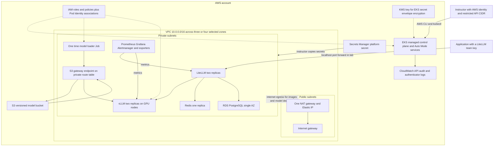

# Astra infrastructure: Console ClickOps or Terraform

This guide reproduces the AWS infrastructure for **Astra in `week08`**, including the active defaults inside its Terraform modules. It assumes Linux, CLI, IAM, and cloud experience. Explain each stage's purpose before creating resources, record the resulting identifiers, and verify its checkpoint before continuing.

| Infrastructure route | Start here | Application deployment |
|---|---|---|
| **AWS Console ClickOps** | [Stages A–L](#a-record-the-build-inputs) below. Create and inspect the resources individually in the Console. | [Kubernetes handoff](#kubernetes-handoff-after-console-clickops), then the existing deployment guide from step 3. |
| **Existing Terraform** | [Terraform route](#terraform-route) below, then steps 1–2 of the existing deployment guide. | The same monitoring, model promotion, serving, gateway, and verification steps. |
| Advanced AWS CLI supplement | [Manual CLI supplement](manual-cli-supplement.md), for instructors who want the equivalent AWS API commands. | Its sections 14–20 provide a complete command-based handoff. |

Choose one infrastructure owner for a fresh lab. Do not apply Terraform over the manually created resources without a separately reviewed import plan. The CLI supplement is an optional implementation aid; it does not replace the Console walkthrough.

**Review date: 17 October 2026.** This revision was checked against local Terraform, installed modules, Kubernetes manifests, and official documentation. These manual paths have not been deployed or rehearsed in AWS. Historical outputs in [deployment-guide.md](deployment-guide.md) describe its earlier build, not validation of these new instructions. Console labels may move; use the specified resource properties as the acceptance criteria.

For model selection, begin with the dated adoption evidence and exact-model comparison in [section 5 of the deployment guide](deployment-guide.md#5-model-adoption-capabilities-and-selection). That comparison includes **Kimi K3**, Qwen, Gemma, gpt-oss, DeepSeek, Llama, and Mistral. Qwen is the current lab candidate; production selection starts with workload evaluation, then hardware sizing.

## What the lab operates

The model weights are the learned parameters loaded for inference. This lab runs existing weights to generate tokens; it does not train or fine-tune them. A prompt's prefill stage processes input tokens, then decoding generates output tokens progressively. The KV cache retains attention state for active sequences. Longer prompts and more concurrent sequences consume more memory and can increase waiting time even when the weights fit.

| Lab component or resource | Responsibility and reason for this design |
|---|---|
| CPU nodes | Run the loader, LiteLLM, Redis, and monitoring. They handle downloads, request validation, accounting, and orchestration without consuming scarce GPU capacity. CPU and host RAM on GPU nodes also support tokenization, file copying, and the serving process. |
| GPU and VRAM | Perform the model's numerical inference and hold weights/cache. Kubernetes `nvidia.com/gpu: 1` allocates a device; it does not add GPU memory to the pod's ordinary RAM limit. Two replicas each load the model independently. |
| vLLM serving engine | Loads the artifact, batches requests, manages model execution/cache, and exposes an OpenAI-compatible API. It is not the model itself. Its context/concurrency settings trade throughput and latency against memory. |
| LiteLLM gateway | Gives applications the stable name `astra`, checks virtual keys, applies budgets/rate limits, records spend, and calls the backend. It separates team policy from model execution. |
| Redis and RDS | Redis coordinates fast counters between gateway replicas; RDS retains teams, keys, and spend. A volatile counter store and a durable database solve different problems. |
| S3 and node storage | S3 retains the promoted model version. Node `emptyDir` holds a disposable serving copy; EBS-backed Prometheus storage retains metrics across pod restarts. RDS has its own managed storage. |
| VPC routing and access controls | Private subnets host nodes/pods/database; NAT permits external downloads; the S3 endpoint bypasses NAT for regional model storage traffic. SGs constrain AWS network paths; NetworkPolicy prevents ordinary pods from bypassing the gateway. |
| IAM and Kubernetes access | Cluster/node roles let AWS operate infrastructure. Pod Identity gives loader/serving pods distinct bucket permissions. An instructor access entry authorizes cluster administration. Team API keys authorize inference clients. These identities are not interchangeable. |
| Prometheus and Grafana | Observe queueing, token throughput, time to first token, replica availability, and internal spend. GPU utilization alone cannot tell whether users receive timely answers. Langfuse request tracing is outside this baseline. |

## Architecture and accurate counts


The arrows to the private subnet group describe network paths, not Kubernetes objects. RDS is an AWS-managed database, not a PostgreSQL pod. EKS runs the control plane in an AWS-managed account and attaches network interfaces in the selected customer subnets. Choosing three control-plane subnets does not mean manually deploying three API-server pods.

| Counting unit | Baseline count | Meaning |
|---|---:|---|
| AWS service families configured by the source and active module defaults | **9** | VPC, EC2 including EBS, EKS, IAM, S3, RDS, Secrets Manager, KMS, CloudWatch Logs. STS is an identity API used by IAM workflows, not an extra deployed application. |
| Terraform-managed instances in the historical four-zone backup | **82** | 76 AWS resources or configuration/association objects, 5 local random passwords, and 1 local wait. This is a historical state count, not a current AWS inventory. |
| General source count with A selected zones | **66 + 4A** | 20 root instances, 33 EKS module instances, 2 KMS module instances, and 11 + 4A VPC module instances. This manual uses A = 3 or 4. |
| Authored Kubernetes objects in `k8s/*.yaml` | **24** | 6 platform, 2 GPU scheduling, 1 loader Job, 7 serving, 7 gateway/Redis, and 1 dashboard. The monitoring values file is chart input, not another Kubernetes object. |
| Kubernetes Secrets created by the source script | **3** | Model API key, gateway environment, Grafana admin credentials. |
| Long-running application and monitoring functions | **9** | vLLM, LiteLLM, Redis, Prometheus Operator, Prometheus, Grafana, Alertmanager, kube-state-metrics, node-exporter. There is also 1 transient model-loader function. Replica and DaemonSet pod counts vary. |

Do not add 9, 82, and 24 together. They count different layers. The 82 includes bucket settings, rules, policy attachments, route associations, and adopted VPC defaults; it is not 82 servers. It excludes EKS-created primary security groups, service-linked roles, ENIs, Auto Mode EC2 instances, instance profiles, and dynamically provisioned EBS volumes. Those service-managed resources have changing counts. Helm also expands into many additional objects; render the chosen chart to count them.

Auto Mode manages node provisioning, networking and service routing, local cluster DNS, Pod Identity delivery, EBS integration, NVIDIA drivers, and the GPU device plugin. The GPU plugin need not appear as a DaemonSet. Do not install another Karpenter, VPC CNI, GPU Operator, NVIDIA device plugin, EBS CSI driver, or Pod Identity Agent over these managed components. See [Auto Mode responsibilities](https://docs.aws.amazon.com/eks/latest/userguide/automode.html) and [accelerated workloads](https://docs.aws.amazon.com/eks/latest/userguide/auto-accelerated.html).

**Different variant:** `../eks-gpu-self-hosted` is the larger platform with Argo CD, Open WebUI, Langfuse and its databases, External Secrets, KEDA, Cognito, Bedrock guardrails/fallback, and DNS/TLS/Ingress. These are not in Astra/week08 Terraform or manifests. Astra uses ClusterIP services and local port forwarding. No ALB/NLB, Route 53 zone, ACM certificate, private ECR repository, ElastiCache cluster, or chat UI is a mandatory creation here. Auto Mode IAM permissions for load balancing do not themselves create a load balancer. The model publisher and public container registries are external download dependencies.

## Source parity and intentional differences

The configuration authority is `week08/terraform`: VPC module **6.7.3**, EKS module **21.29.0**, and nested KMS module **4.0.0**, as installed in `.terraform/modules/modules.json`. The constraints allow future compatible releases; check the resolved versions before teaching. This guide covers their active resources, including adopted defaults, policy attachments, rules, and associations.

- Use a dedicated fresh lab name. Human-readable names replace Terraform-generated suffixes. Add `Project=astra`, `Environment=lab`, and `ManagedBy=manual` to taggable resources; Terraform uses `ManagedBy=terraform`. Resource `Name` tags identify the stage and cluster.
- The source checks for two GPU zones but slices the first **three** private subnets for EKS. Require at least three eligible zones for this unchanged implementation. Up to four are used for workers and RDS.
- Preserve the installed module's legacy `AmazonEKSBlockStoragePolicy` for exact coverage. Current AWS instructions recommend V2; a migration needs a corresponding source change and volume/tag compatibility testing. Do not attach both without a deliberate migration plan.
- The module creates extra cluster/node security groups and an OIDC provider. Include them even though Astra's GPU NodeClass uses the **EKS primary SG** and the S3 roles use **Pod Identity**.
- Console defaults can add resources the source never requested. Disable optional add-ons, database integrations, extra monitoring agents, and automatic role generation where this guide supplies the role explicitly.
- The Console cannot reproduce Secrets Manager's zero-day deletion directly. [Cleanup](#cleanup-for-the-console-route) documents the one optional AWS CLI operation for exact deletion parity, or the Console's scheduled-deletion difference.

## A Record the build inputs

**Purpose:** establish the account, resource identity, compatible versions, GPU placement, and cost boundary before billable resources exist.

1. Select the intended AWS account and **us-east-1** in the Console. Record the stable IAM user/role ARN that will administer the cluster; for an assumed role use its IAM role ARN, not the temporary STS session ARN.
2. In **Service Quotas → AWS services → Amazon EC2**, check **Running On-Demand G and VT instances**. Two `g6e.xlarge` replicas need 8 vCPUs; the permitted `g6e.4xlarge` fallback and third rollout GPU can require **48 vCPUs**. Existing G/VT usage also consumes the quota.
3. Check `g6e.xlarge` offerings by Availability Zone. The small read-only lookup below exactly reproduces Terraform's discovery; EC2's Console instance-type view alone does not establish the selected zone list. Take the first up to four sorted zone names. Offerings do not guarantee immediate capacity.
4. In **EKS → Add cluster → Create**, inspect available versions without creating a cluster. The source requests **1.36**. Confirm it is supported in the chosen region and compatible with your kubectl and manifests; do not silently substitute a version.
5. Review [EKS pricing](https://aws.amazon.com/eks/pricing/), [EC2 pricing](https://aws.amazon.com/ec2/pricing/on-demand/), and the [AWS calculator](https://calculator.aws/). Include Auto Mode fees, CPU nodes, EBS, RDS, NAT/EIP, logs, secrets, and S3, not only GPUs. Set a cleanup time for the class.

The following lookup creates no infrastructure. Authenticate with your normal SSO/assumed-role profile first. Authenticate with your normal SSO/assumed-role profile first. Record its result as `AZ1` through `AZ4`; stop if fewer than three zones are returned.

```bash
aws ec2 describe-instance-type-offerings --region us-east-1 \
  --location-type availability-zone \
  --filters Name=instance-type,Values=g6e.xlarge \
  --query 'sort(InstanceTypeOfferings[].Location)[:4]' --output json
```

| Ledger field | Value or source |
|---|---|
| `AWS_REGION`, `ACCOUNT_ID` | `us-east-1`, intended account ID |
| `CLUSTER`, `ENVIRONMENT` | `astra-lab`, `lab`; choose a distinct cluster name for another run |
| `ADMIN_PRINCIPAL_ARN`, `ADMIN_CIDR` | Stable instructor IAM principal; current permitted public egress IP/CIDR |
| `AZ1`…`AZ4`, `PRIVATE_SUBNET_IDS` | Sorted offering zones; IDs created in B |
| `VPC_ID`, `PUBLIC_RT`, `PRIVATE_RT`, `NAT_ID`, `EIP_ID` | IDs created in B–C |
| `BUCKET` | Globally unique model bucket created in D |
| `CLUSTER_ROLE_ARN`, `NODE_ROLE`, `NODE_ROLE_ARN` | Cluster role ARN and node role name/ARN from E |
| `KMS_KEY_ARN`, `EXTRA_CLUSTER_SG`, `EXTRA_NODE_SG` | F–G |
| `CLUSTER_SG` | **Primary** security group reported by EKS after H, not either extra SG |
| `DB_HOST`, `SECRET_ID` | RDS endpoint and platform secret ARN from K–L |

Store the ledger privately outside Git. Passwords belong in the password manager and Secrets Manager, not in this identifier ledger. Use the same names and account/region throughout.

## B Create the VPC subnets and default configuration

**Purpose:** reproduce the VPC module without the Console wizard's extra route tables or per-zone NAT gateways.

1. Open **VPC → Your VPCs → Create VPC**. Select **VPC only**. Name it `astra-lab`, enter `10.0.0.0/16`, IPv4 only, default tenancy. Create it and record `VPC_ID`.
2. Select the VPC → **Actions → Edit VPC settings**. Enable both DNS resolution and DNS hostnames.
3. Open **Security groups**, filter to `VPC_ID`, select its `default` group. Remove all inbound and outbound rules. This is an adopted default, not a new group. Do not change the default SG of another VPC.
4. Open **Network ACLs**, select this VPC's default ACL. For **both inbound and outbound**, retain rule 100 allowing all protocols/ports from/to `0.0.0.0/0`; add rule 101 allowing all protocols/ports from/to `::/0` if absent. Leave the final deny rule. IPv6 rules match module defaults even though this VPC is IPv4-only. Keep subnet associations with this ACL.
5. Open **Route tables**, select the VPC's **Main = Yes** table. Retain only its automatic local route and no VPN propagation. The two explicit routing tables are created in C; no subnet should rely on the main table for internet egress.
6. In **Subnets → Create subnet**, select this VPC and create one private and one public subnet per recorded zone, in the order below. Use the actual account-specific zone names from A. Omit row four if only three zones qualify.

| Zone position | Private name and CIDR | Public name and CIDR |
|---|---|---|
| AZ1 | `astra-lab-private-1`, `10.0.0.0/20` | `astra-lab-public-1`, `10.0.240.0/24` |
| AZ2 | `astra-lab-private-2`, `10.0.16.0/20` | `astra-lab-public-2`, `10.0.241.0/24` |
| AZ3 | `astra-lab-private-3`, `10.0.32.0/20` | `astra-lab-public-3`, `10.0.242.0/24` |
| AZ4 | `astra-lab-private-4`, `10.0.48.0/20` | `astra-lab-public-4`, `10.0.243.0/24` |

On **each subnet → Actions → Edit subnet settings**, leave automatic public IPv4 assignment off, including on public subnets. Add `astra/cluster=astra-lab` and `kubernetes.io/role/internal-elb=1` to private subnets; add `kubernetes.io/role/elb=1` to public subnets. Add the shared project/environment/management tags to both.

**Checkpoint:** six or eight subnets with nonoverlapping CIDRs, correct zones and discovery tags; DNS settings enabled; empty default SG; default ACL and main route table match the settings above. No extra database subnets, IPv6 allocation, flow logs, custom DHCP options, or VPN is requested. [VPC creation reference](https://docs.aws.amazon.com/vpc/latest/userguide/create-vpc.html).

## C Connect internet egress and the S3 route

**Purpose:** nodes download images and the initial model through NAT; regional S3 copies subsequently use the gateway endpoint.

1. **VPC → Internet gateways → Create internet gateway**: `astra-lab`, then **Actions → Attach to VPC** → `VPC_ID`.
2. **VPC → Elastic IPs → Allocate Elastic IP address**: allocate an Amazon-provided VPC address in the region's network border group. Record the allocation ID.
3. **VPC → NAT gateways → Create NAT gateway**: `astra-lab`, **Public** connectivity, first public subnet in AZ1, allocated EIP. Wait for **Available**. Create only one NAT gateway.
4. **Route tables → Create route table**: `astra-lab-public`, this VPC. **Routes → Edit routes**: `0.0.0.0/0` → the internet gateway. **Subnet associations → Edit**: associate every public subnet.
5. Create `astra-lab-private`. Add `0.0.0.0/0` → the NAT gateway; associate every private subnet. Retain each table's local route.
6. **VPC → Endpoints → Create endpoint**: AWS services, `com.amazonaws.us-east-1.s3`, type **Gateway**, this VPC, select only `astra-lab-private`, policy **Full access**. No endpoint security group is needed. Record the endpoint ID.

**Checkpoint:** public subnets use the IGW table, private subnets use the NAT table, and the private table also has an S3 prefix-list route to the endpoint. S3 traffic avoids NAT processing charges; S3 storage/requests and other applicable transfer charges still exist. One NAT is a cost/availability shortcut, not zone-independent egress. The endpoint policy permits access but does not replace IAM or bucket permissions.

## D Create the versioned model bucket

**Purpose:** retain the reviewed checkpoint independently of short-lived GPU nodes.

Open **S3 → General purpose buckets → Create bucket**. Choose us-east-1, a unique name such as `astra-lab-models-ACCOUNT_ID-SUFFIX`, and ACLs disabled. Keep **all four Block Public Access settings on**, enable **Bucket Versioning**, and use default S3-managed encryption (SSE-S3). Add the common tags. Do not enable Object Lock, replication, a custom KMS key, or lifecycle rules for this exact baseline.

Record `BUCKET`. Verify the public-access block and versioning on the bucket's **Permissions** and **Properties** tabs. Source `force_destroy=true` is a Terraform deletion behavior, not a bucket property; Console cleanup must empty all object versions and delete markers first.

## E Create the IAM roles and custom-tag policy

**Purpose:** separate AWS infrastructure permissions from the loader's write access and vLLM's read access. Create roles in **IAM → Roles → Create role → Custom trust policy**. Add common tags. Substitute your names only where marked; IAM policy variables beginning `${aws:...}` must remain literal.

| Role name | Trust principal | Initial AWS-managed attachments |
|---|---|---|
| `astra-lab-cluster` | `eks.amazonaws.com` | `AmazonEKSClusterPolicy`, `AmazonEKSComputePolicy`, `AmazonEKSBlockStoragePolicy`, `AmazonEKSLoadBalancingPolicy`, `AmazonEKSNetworkingPolicy` |
| `astra-lab-node` | `ec2.amazonaws.com` | `AmazonEKSWorkerNodeMinimalPolicy`, `AmazonEC2ContainerRegistryPullOnly` |
| `astra-lab-model-loader` | `pods.eks.amazonaws.com` | None; exact S3 inline policy added in I |
| `astra-lab-vllm` | `pods.eks.amazonaws.com` | None; exact S3 inline policy added in I |

Use the following trust document for each role, changing only `SERVICE_PRINCIPAL` to the corresponding table value. Both actions reproduce the installed module and source. Do not give application S3 access to the node role.

```json
{"Version":"2012-10-17","Statement":[{"Effect":"Allow","Principal":{"Service":"SERVICE_PRINCIPAL"},"Action":["sts:AssumeRole","sts:TagSession"]}]}
```

For each AWS-managed attachment, open the role → **Permissions → Add permissions → Attach policies**, select the exact policy name, and attach it. Check there are five cluster attachments and two node attachments before adding the customer policies below. Current [AWS cluster-role guidance](https://docs.aws.amazon.com/eks/latest/userguide/auto-cluster-iam-role.html) uses V2 block-storage permissions; the parity choice is explained above.

Open **IAM → Policies → Create policy → JSON**. Paste this exact custom-tag policy, name it `astra-lab-auto-custom-tags`, tag it, create it, then attach it to `astra-lab-cluster`.

```json
{
  "Version": "2012-10-17",
  "Statement": [
    {
      "Sid": "Compute",
      "Effect": "Allow",
      "Action": [
        "ec2:CreateFleet",
        "ec2:RunInstances",
        "ec2:CreateLaunchTemplate"
      ],
      "Resource": [
        "*"
      ],
      "Condition": {
        "StringEquals": {
          "aws:RequestTag/eks:eks-cluster-name": "${aws:PrincipalTag/eks:eks-cluster-name}"
        },
        "StringLike": {
          "aws:RequestTag/eks:kubernetes-node-class-name": "*",
          "aws:RequestTag/eks:kubernetes-node-pool-name": "*"
        }
      }
    },
    {
      "Sid": "Storage",
      "Effect": "Allow",
      "Action": [
        "ec2:CreateVolume",
        "ec2:CreateSnapshot"
      ],
      "Resource": [
        "arn:aws:ec2:*:*:volume/*",
        "arn:aws:ec2:*:*:snapshot/*"
      ],
      "Condition": {
        "StringEquals": {
          "aws:RequestTag/eks:eks-cluster-name": "${aws:PrincipalTag/eks:eks-cluster-name}"
        }
      }
    },
    {
      "Sid": "Networking",
      "Effect": "Allow",
      "Action": [
        "ec2:CreateNetworkInterface"
      ],
      "Resource": [
        "*"
      ],
      "Condition": {
        "StringEquals": {
          "aws:RequestTag/eks:eks-cluster-name": "${aws:PrincipalTag/eks:eks-cluster-name}",
          "aws:RequestTag/eks:kubernetes-cni-node-name": "*"
        }
      }
    },
    {
      "Sid": "LoadBalancer",
      "Effect": "Allow",
      "Action": [
        "elasticloadbalancing:CreateLoadBalancer",
        "elasticloadbalancing:CreateTargetGroup",
        "elasticloadbalancing:CreateListener",
        "elasticloadbalancing:CreateRule",
        "ec2:CreateSecurityGroup"
      ],
      "Resource": [
        "*"
      ],
      "Condition": {
        "StringEquals": {
          "aws:RequestTag/eks:eks-cluster-name": "${aws:PrincipalTag/eks:eks-cluster-name}"
        }
      }
    },
    {
      "Sid": "ShieldProtection",
      "Effect": "Allow",
      "Action": [
        "shield:CreateProtection"
      ],
      "Resource": [
        "*"
      ],
      "Condition": {
        "StringEquals": {
          "aws:RequestTag/eks:eks-cluster-name": "${aws:PrincipalTag/eks:eks-cluster-name}"
        }
      }
    },
    {
      "Sid": "ShieldTagResource",
      "Effect": "Allow",
      "Action": [
        "shield:TagResource"
      ],
      "Resource": [
        "arn:aws:shield::*:protection/*"
      ],
      "Condition": {
        "StringEquals": {
          "aws:RequestTag/eks:eks-cluster-name": "${aws:PrincipalTag/eks:eks-cluster-name}"
        }
      }
    }
  ]
}
```

This creates one customer-managed policy and one attachment. The networking statement deliberately preserves the installed module's literal `StringEquals` value `*`; it is not a wildcard match. Diagnose that condition if custom ENI tagging fails. Shield permissions are latent permissions in the module policy; this lab creates no Shield protection and needs no Shield Advanced subscription. The GPU NodeClass later requests the `Workload` tag, so omitting custom-tag permissions can break provisioning.

**Checkpoint:** four roles with the correct service trusts; five plus two AWS-managed attachments; one customer policy attached to the cluster role. Record both infrastructure role ARNs and the node role **name**.

## F Create KMS encryption and CloudWatch logging

**Purpose:** reproduce the EKS module's envelope-encryption and control-plane audit defaults. This key is not automatically used by S3, RDS, node volumes, or logs.

1. **KMS → Customer managed keys → Create key**: symmetric, encrypt/decrypt, KMS-generated material, single-region. Alias `eks/astra-lab` (displayed as `alias/eks/astra-lab`). Add common tags. Select the stable instructor IAM principal as administrator and cluster role as key user.
2. Before EKS creation, open the key's **Key policy → Edit** and use the policy below. Replace `ACCOUNT_ID`, `ADMIN_PRINCIPAL_ARN`, and `CLUSTER_ROLE_ARN` with actual values. Preserve the account delegation statement. Wizard-added grant statements would be a difference from the module; the exact policy below contains none.
3. Enable automatic key rotation with **365 days**. Record `KMS_KEY_ARN`.

```json
{
  "Version": "2012-10-17",
  "Statement": [
    {
      "Sid": "Default",
      "Effect": "Allow",
      "Principal": {
        "AWS": "arn:aws:iam::ACCOUNT_ID:root"
      },
      "Action": [
        "kms:*"
      ],
      "Resource": "*"
    },
    {
      "Sid": "KeyAdministration",
      "Effect": "Allow",
      "Principal": {
        "AWS": "ADMIN_PRINCIPAL_ARN"
      },
      "Action": [
        "kms:Create*",
        "kms:Describe*",
        "kms:Enable*",
        "kms:List*",
        "kms:Put*",
        "kms:Update*",
        "kms:Revoke*",
        "kms:Disable*",
        "kms:Get*",
        "kms:Delete*",
        "kms:TagResource",
        "kms:UntagResource",
        "kms:ScheduleKeyDeletion",
        "kms:CancelKeyDeletion",
        "kms:ReplicateKey",
        "kms:ImportKeyMaterial"
      ],
      "Resource": "*"
    },
    {
      "Sid": "KeyUsage",
      "Effect": "Allow",
      "Principal": {
        "AWS": "CLUSTER_ROLE_ARN"
      },
      "Action": [
        "kms:Encrypt",
        "kms:Decrypt",
        "kms:ReEncrypt*",
        "kms:GenerateDataKey*",
        "kms:DescribeKey"
      ],
      "Resource": "*"
    }
  ]
}
```

Create a customer-managed IAM policy named `astra-lab-ClusterEncryption` in the JSON editor and attach it to the cluster role. Replace `KMS_KEY_ARN` with the actual key ARN.

```json
{"Version":"2012-10-17","Statement":[{"Effect":"Allow","Action":["kms:Encrypt","kms:Decrypt","kms:ListGrants","kms:DescribeKey"],"Resource":"KMS_KEY_ARN"}]}
```

Open **CloudWatch → Logs → Log groups → Create log group**. Name it exactly `/aws/eks/astra-lab/cluster`, standard log class, retention **90 days**, common tags, no customer KMS key. If the UI sets retention after creation, open the group's retention setting and change it then.

**Checkpoint:** enabled CMK, alias and rotation; two customer-managed policies attached to the cluster role in total; log group with 90-day retention. No separate KMS grant, replica key, or external key material is required.

## G Reproduce the module security groups

**Purpose:** include the module-created groups even though GPU nodes will select EKS's separate primary SG.

In **VPC → Security groups → Create security group**, create `astra-lab-cluster-extra` and `astra-lab-node-extra` in `VPC_ID`. Add common tags and `kubernetes.io/cluster/astra-lab=owned` to the node group. Record both IDs before adding cross-references. Remove the default outbound rule from the extra cluster group. Keep only IPv4 allow-all outbound on the extra node group; do not add IPv6 egress.

Use **Inbound rules → Edit inbound rules** to reproduce this exact table. A source marked “self” means that group's own ID, not a CIDR.

| Group | Direction | Protocol and ports | Source or destination | Rule count |
|---|---|---|---|---:|
| Extra cluster SG | Inbound | TCP 443 | Extra node SG | 1 |
| Extra cluster SG | Outbound | None | None | 0 |
| Extra node SG | Inbound | TCP 443, 10250, 4443, 10251, 6443, 8443, 9443 | Extra cluster SG; one rule per port | 7 |
| Extra node SG | Inbound | TCP 53; UDP 53 | Self; separate rules | 2 |
| Extra node SG | Inbound | TCP 1025–65535 | Self | 1 |
| Extra node SG | Outbound | All traffic | `0.0.0.0/0` | 1 |

**Checkpoint:** one extra-cluster rule and eleven extra-node rules. These are additional groups; do not confuse either with the primary SG EKS creates next.

## H Create EKS Auto Mode and instructor access

**Purpose:** bind the prepared networking, identities, encryption, and logging to the managed control plane. Use the [advanced Auto Mode Console workflow](https://docs.aws.amazon.com/eks/latest/userguide/create-cluster-auto.html).

Open **EKS → Add cluster → Create → Custom configuration**. Keep **Use EKS Auto Mode** enabled. Apply the local-source settings below; do not let Quick configuration create replacement roles or networking.

| Configuration area | Required Astra setting |
|---|---|
| Name and version | `astra-lab`; source version `1.36`, subject to A's support check |
| Cluster role | `astra-lab-cluster` |
| Auto Mode compute | Built-in `system` and `general-purpose` pools enabled; node role `astra-lab-node` |
| Access | **Disallow** bootstrap administrator access; authentication **EKS API and ConfigMap** |
| Secrets encryption | Enable with the CMK from F |
| Networking | `VPC_ID`; select only the **first three private subnets**, not public subnets or the optional fourth |
| Additional security group | Extra cluster SG from G, not extra node SG |
| IP family and service CIDR | IPv4; let EKS assign the service CIDR, as the source does |
| Endpoint | Public **and** private; restrict public CIDRs to the recorded instructor egress CIDR(s) |
| Observability | API, audit, authenticator logs on; controller-manager and scheduler logs off. No additional managed Prometheus scraper/agent. |
| Add-ons | No additional EKS/Marketplace add-ons, managed node groups, or Fargate profiles. Auto Mode supplies its managed networking, DNS, storage, and identity integrations. |
| Tags | Project, Environment, ManagedBy as above |

The source leaves upgrade policy unset; do not describe a chosen Console policy as source-pinned. Record the effective policy. Selecting Standard to avoid extended-support fees is an explicit operational change if AWS's default is Extended.

Review the summary, create, and wait for **Active**. The module explicitly sets `bootstrap_self_managed_addons=false`; the Auto Mode path with no additional add-ons is the intended equivalent. Verify that no self-managed `aws-node`, `kube-proxy`, or CoreDNS installation was added. If the current wizard forces such an installation, stop before creation and use the precisely specified cluster call in [CLI section 9](manual-cli-supplement.md#9-create-eks-auto-mode-and-authorize-the-instructor) as a disclosed fallback; do not claim exact Console parity after accepting extra components.

Open the cluster's **Access** tab → **Create access entry**. Select the stable instructor IAM ARN, type **Standard**, then associate **AmazonEKSClusterAdminPolicy** with **cluster** scope. Leave Kubernetes groups empty. This entry replaces the disabled implicit bootstrap grant. It is an EKS access policy, not an IAM managed-policy attachment.

On **Networking**, record the EKS-created **cluster primary security group ID** as `CLUSTER_SG`. On the cluster's configuration/details, record its OIDC issuer URL for J. Check Auto Mode compute, load-balancing integration, and block-storage integration are enabled; enabling integrations does not create a load balancer. Allow IAM/EKS propagation after readiness (the module waits 30 seconds), then verify access during the handoff.

**Checkpoint:** Active cluster, both built-in pools, correct endpoint CIDRs, three control-plane subnets, encryption key, three log types, explicit administrator entry and policy association. RDS and GPU nodes will reference the primary SG.

## I Add the S3 workload policies and Pod Identity associations

**Purpose:** the CPU loader may publish the approved artifact; the GPU serving pods may only read it.

For each workload role in **IAM → Roles → role → Permissions → Add permissions → Create inline policy → JSON**, paste this policy and name it `models-bucket`. Replace `MODEL_BUCKET` with the actual bucket. The loader policy is shown first.

```json
{"Version":"2012-10-17","Statement":[
 {"Effect":"Allow","Action":["s3:ListBucket"],"Resource":"arn:aws:s3:::MODEL_BUCKET"},
 {"Effect":"Allow","Action":["s3:GetObject","s3:PutObject","s3:AbortMultipartUpload"],"Resource":"arn:aws:s3:::MODEL_BUCKET/*"}
]}
```

For `astra-lab-vllm`, use the same bucket-list statement but make the object-action list **only** `["s3:GetObject"]`. Both roles retain the `pods.eks.amazonaws.com` trust with AssumeRole and TagSession from E.

Open **EKS → astra-lab → Access → Pod Identity associations → Create**. Create these two bindings. Namespace and service-account names may be specified before Kubernetes creates them. Use no optional target role or association conditions for source parity.

| Namespace | Service account | IAM role |
|---|---|---|
| `llm` | `model-loader` | `astra-lab-model-loader` |
| `llm` | `vllm` | `astra-lab-vllm` |

**Checkpoint:** two inline policies and two EKS associations with exact names. Auto Mode provides Pod Identity delivery; do not install another agent. [Association reference](https://docs.aws.amazon.com/eks/latest/userguide/pod-id-association.html).

## J Create the module default OIDC provider

**Purpose:** account for `enable_irsa=true` in the installed EKS module. Astra's actual S3 access still uses Pod Identity.

Open **IAM → Identity providers → Add provider**. Type **OpenID Connect**, provider URL = this cluster's exact OIDC issuer from H, audience = `sts.amazonaws.com`. If prompted, retrieve/validate its certificate thumbprint through the Console. Create, tag, and record its ARN. Do not invent a thumbprint or create IRSA roles for the two workloads.

**Checkpoint:** one IAM OIDC provider with the exact cluster issuer and STS audience. Certificate discovery is a lookup, not another deployed resource.

## K Create private PostgreSQL

**Purpose:** persist gateway teams, keys, and spend independently of gateway pods. Redis will handle fast transient counters later.

1. **RDS → Subnet groups → Create DB subnet group**: name `astra-lab-gateway`, this VPC, all three or four private subnets. Do not choose public subnets.
2. **VPC → Security groups → Create**: `astra-lab-gateway-db`, this VPC. Add inbound TCP **5432** with source **CLUSTER_SG**, the EKS primary SG. Remove the default outbound rule; the source declares no egress. Add common tags.
3. **RDS → Databases → Create database → Standard create**. Select PostgreSQL, a supported **17.x** minor (the source pins major 17), and a template that permits explicit settings. Configure the table below before choosing Create database.

| RDS setting | Exact baseline |
|---|---|
| Deployment | Single DB instance / Single-AZ |
| Identifier / instance class | `astra-lab-gateway` / burstable `db.t4g.small` |
| Credentials | Master username `litellm`; self-managed password, 32 random alphanumeric characters from a password manager. Do not enable RDS-managed master credentials for this source path. |
| Storage | gp3, 20 GiB, encryption enabled with the default RDS key; storage autoscaling off |
| Network | This VPC, the DB subnet group above, **Public access: No**, only the DB SG above, port 5432; no automatic EC2 connection |
| Additional configuration | Initial database name **litellm**; default parameter/option groups; password authentication |
| Backups | Retain 7 days; leave backup/maintenance scheduling to the service defaults |
| Other options | Deletion protection off; no read replica, Multi-AZ standby, RDS Proxy, IAM DB authentication, enhanced-monitoring role, or optional log export |

Review current optional Database Insights/Performance Insights settings rather than accepting paid or additional integrations automatically; the source does not configure them. The source's `skip_final_snapshot=true` applies at deletion, not creation.

Wait for **Available**. From **Connectivity & security**, record the endpoint hostname as `DB_HOST` and verify the primary-SG source rule, subnet group, encryption, and private status. A two-zone vLLM deployment does not make this single-AZ database highly available.

## L Store the platform secret

**Purpose:** create the five fields consumed by the existing gateway and secret-copy workflow.

Generate independent alphanumeric values with a password manager: LiteLLM master **40** characters, LiteLLM salt **40**, vLLM API key **40**, Grafana password **24**. Keep the DB password generated in K. Add the prefix `sk-` to the master value only. These replace Terraform's five local `random_password` resources, including the DB password.

Open **Secrets Manager → Store a new secret → Other type of secret**. Enter exactly these keys and values, use the default Secrets Manager encryption key, name it `astra-lab/platform-SUFFIX`, add common tags, and leave automatic rotation off. Do not save example placeholders as real values.

| Key | Value |
|---|---|
| `litellm_master_key` | `sk-` followed by the generated 40-character master value |
| `litellm_salt_key` | Independent 40-character value |
| `vllm_api_key` | Independent 40-character value |
| `grafana_password` | Independent 24-character value |
| `database_url` | `postgresql://litellm:DB_PASSWORD@DB_HOST:5432/litellm`, substituting both values |

The alphanumeric DB password avoids URL-encoding ambiguity in this source format. Record the secret ARN as `SECRET_ID`. One Console save creates both the secret container and its first version; Terraform represents them as two resources. Verify all five key names without putting their values in screenshots, Git, or the resource ledger.

## Kubernetes handoff after Console ClickOps

**This is application deployment, separate from AWS infrastructure creation.** AWS Console does not install the repository's Kubernetes manifests or Helm release. Use Bash with AWS CLI, kubectl, Helm, Python 3, and the repository's application dependencies. Authenticate with the administrator role granted in H.

Run from `week08`, the directory containing `terraform/`, `k8s/`, and `scripts/`. Fill the following values from the Console ledger. They replace Terraform outputs; do not run `scripts/render.sh` or `scripts/create-secrets.sh` on this route.

```bash
set -euo pipefail
set +x
umask 077
export AWS_REGION=us-east-1
export AWS_DEFAULT_REGION="$AWS_REGION"
export AWS_PAGER=""
export AWS_PAGER=""
export CLUSTER=astra-lab
export CLUSTER_SG=REPLACE_WITH_EKS_PRIMARY_SG
export NODE_ROLE=astra-lab-node
export BUCKET=REPLACE_WITH_MODEL_BUCKET
export SECRET_ID=REPLACE_WITH_PLATFORM_SECRET_ARN
export LAB_DIR="$HOME/astra-console-lab"
mkdir -p "$LAB_DIR/private" "$LAB_DIR/manifests" build
aws sts get-caller-identity
aws eks update-kubeconfig --region "$AWS_REGION" --name "$CLUSTER"
kubectl get nodepools
```

Check that the printed account and kubeconfig target match the intended build. Auto Mode's built-in pools should be ready; no GPU node is expected before a GPU workload requests one.

Render the existing YAML with the seven known substitutions. This only writes local files and fails if a placeholder remains. The two costs are the source's internal accounting prices, not AWS charges.

```bash
export INPUT_COST=0.00000045
export OUTPUT_COST=0.00000227
python3 - <<'PY'
import os,re
from pathlib import Path
e=os.environ
values={"__REGION__":e["AWS_REGION"],"__CLUSTER_NAME__":e["CLUSTER"],
 "__CLUSTER_SG__":e["CLUSTER_SG"],"__NODE_ROLE__":e["NODE_ROLE"],
 "__MODEL_BUCKET__":e["BUCKET"],"__INPUT_COST__":e["INPUT_COST"],
 "__OUTPUT_COST__":e["OUTPUT_COST"]}
out=Path(e["LAB_DIR"])/"manifests"
for source in sorted(Path("k8s").glob("*.yaml")):
    text=source.read_text()
    for key,value in values.items(): text=text.replace(key,value)
    assert not re.search(r"__[A-Z_]+__",text), source
    (out/source.name).write_text(text)
print("Rendered",len(list(out.glob('*.yaml'))),"files")
PY
```

Apply the platform manifest to create three namespaces, the loader service account, encrypted gp3 StorageClass, and Auto Mode network-policy configuration. The StorageClass creates no EBS volume until a claim is used.

```bash
kubectl apply -f "$LAB_DIR/manifests/00-platform.yaml"
kubectl get namespace llm gateway monitoring
kubectl get storageclass gp3
```

Fetch the platform secret privately and create the three Kubernetes Secrets. This is a one-time copy; changing Secrets Manager later does not update running pods automatically. The block prints only Kubernetes object status, not secret values.

```bash
aws secretsmanager get-secret-value --secret-id "$SECRET_ID" \
  --query SecretString --output text > "$LAB_DIR/private/platform.json"
python3 - <<'PY' | kubectl apply -f -
import base64,json,os
from pathlib import Path
p=Path(os.environ["LAB_DIR"])/"private/platform.json"
s=json.loads(p.read_text())
items=[("llm","vllm-api-key",{"api-key":s["vllm_api_key"]}),
 ("gateway","litellm-env",{"LITELLM_MASTER_KEY":s["litellm_master_key"],
  "LITELLM_SALT_KEY":s["litellm_salt_key"],"DATABASE_URL":s["database_url"],
  "VLLM_API_KEY":s["vllm_api_key"]}),
 ("monitoring","grafana-admin",{"admin-user":"admin","admin-password":s["grafana_password"]})]
print(json.dumps({"apiVersion":"v1","kind":"List","items":[
 {"apiVersion":"v1","kind":"Secret","metadata":{"namespace":ns,"name":name},
  "type":"Opaque","data":{k:base64.b64encode(v.encode()).decode() for k,v in values.items()}}
 for ns,name,values in items]}))
PY
rm -- "$LAB_DIR/private/platform.json"
kubectl -n llm get secret vllm-api-key
kubectl -n gateway get secret litellm-env
kubectl -n monitoring get secret grafana-admin
```

Copy the rendered manifests into the repository's ignored `build/` directory so the existing deployment commands use the same paths. Inspect names before overwriting an earlier lab's rendered files.

```bash
cp "$LAB_DIR"/manifests/*.yaml build/
```

Continue at [deployment guide step 3](deployment-guide.md#step-3-install-monitoring): monitoring CRDs first, then GPU NodeClass/NodePool, model-loader Job, two vLLM replicas, gateway/Redis, teams, API calls, and observability. Keep this Console handoff's variables and paths; the advanced CLI route has its own ledger setup. The loader promotes the pinned Qwen revision to S3; `_PROMOTED` marks completion, not cryptographic integrity. It needs CPU/RAM/disk, not a GPU.

Before declaring the lab ready, verify both vLLM replicas, actual node-zone placement, authenticated generation, wrong-key rejection, NetworkPolicy isolation, gateway DB connectivity, team spend/rate/budget behavior, and Prometheus targets/dashboard data. The current spread rule has no `minDomains`, so inspect placement rather than assuming two distinct zones are guaranteed. Load-test the 32,768-token context and concurrency settings; KV-cache pressure can limit usable concurrency well below the request cap.

## Terraform route

**Purpose:** use the existing code to provision and track the same infrastructure when the lesson is focused on inference operations rather than resource-by-resource Console work.

Run this route on a fresh lab instead of A–L. Keep the existing provider lockfile, inspect resolved module versions, and protect state/plan files because they contain secret values. The commented S3 backend does not create or activate remote state.

From `week08`, copy the example inputs and identify the administrator's permitted public egress CIDR before planning.

```bash
cd terraform
cp terraform.tfvars.example terraform.tfvars
curl -s https://checkip.amazonaws.com
```

Set `admin_cidrs` in `terraform.tfvars` to your permitted address(es); review region, naming, Kubernetes version, GPU type, and DB class. Perform A's GPU-zone/version/quota checks: the existing two-zone validation does not protect the three-subnet slice. This documentation does not change that Terraform expression.

Initialize, review the saved plan for the expected service families and resources, then apply only the plan you inspected. The historical four-zone count is 82; a different module resolution or zone count requires a fresh explanation of the plan.

```bash
terraform init
terraform plan -out tfplan
terraform apply tfplan
cd ..
```

Continue with [deployment guide step 2](deployment-guide.md#step-2-connect-to-the-cluster-and-lay-the-basics), including its Terraform-output renderer and secret-copy scripts, then steps 3–13. Use the same model-evaluation and acceptance criteria as the Console route. For teardown, use [its Terraform cleanup](deployment-guide.md#step-14-tear-it-down), after removing Kubernetes-created workloads and persistent volumes. Do not mix that destroy command with a Console-owned build.

## Cleanup for the Console route

**Purpose:** remove dependent Kubernetes resources while controllers still exist, then remove AWS resources in dependency order. Confirm account, region, cluster, bucket, and VPC IDs against the ledger first. Only delete this dedicated lab's resources.

First remove applications using the same Console handoff's `LAB_DIR`. This dedicated lab owns all Jobs in `llm` and all PVCs in `monitoring`. Record the Prometheus EBS volume IDs before deletion and check that those exact volumes disappear in **EC2 → Volumes** while EKS still exists.

```bash
kubectl get pv -o 'custom-columns=PV:.metadata.name,NAMESPACE:.spec.claimRef.namespace,CLAIM:.spec.claimRef.name,VOLUME:.spec.csi.volumeHandle'
kubectl delete -f "$LAB_DIR/manifests/40-gateway.yaml" --ignore-not-found
kubectl delete -f "$LAB_DIR/manifests/30-vllm.yaml" --ignore-not-found
kubectl -n llm delete jobs --all --ignore-not-found
helm uninstall monitoring -n monitoring --wait --timeout 10m
kubectl -n monitoring delete pvc --all --wait=true --timeout=10m
kubectl delete nodepool gpu --ignore-not-found
kubectl delete nodeclass gpu --ignore-not-found
kubectl get nodes -L node.kubernetes.io/instance-type
```

Do not continue to cluster deletion while a volume's reclaim/finalizer processing is unresolved. Record any intentionally retained volume and its ongoing cost.

1. Wait for GPU nodes and provisioned EBS volumes to disappear. Check load balancers if any were added beyond the baseline. Inspect CPU nodes too; EKS deletion removes remaining Auto Mode capacity.
2. **RDS → database → Actions → Delete**: confirm the lab identifier, choose no final snapshot and no retained automated backups only if reproducing the disposable source. Wait until deleted, then delete its subnet group and DB SG. Retained snapshots/backups remain billable.
3. **Secrets Manager → secret → Actions → Delete secret** schedules deletion with a recovery window. The source uses immediate deletion. For exact parity, the explicitly destructive CLI command below is the narrow exception; otherwise record the scheduled-deletion date and use a new suffix on the next lab.
4. **EKS → cluster → Access**: remove the two Pod Identity associations. Delete the cluster and wait for removal. Verify Auto Mode instances and their volumes/ENIs have terminated; enable the EC2 Console's visibility of AWS-managed resources when inspecting them.
5. **S3 → exact bucket → Empty**, confirm deletion of all versions and delete markers, then delete the bucket. Check incomplete multipart uploads if an interrupted promotion leaves charges.
6. **IAM**: delete the cluster's OIDC provider; detach all cluster/node managed-policy attachments; delete the two workload inline policies and four roles. Delete the two customer-managed policies after all attachments are gone. Do not delete AWS-managed policies or shared service-linked roles.
7. **CloudWatch Logs**: delete `/aws/eks/CLUSTER/cluster`. **KMS**: delete its alias and schedule the customer key for deletion with a **30-day** waiting period, matching the module. Record the pending-deletion key; it is not already physically deleted.
8. **VPC → Endpoints**: delete the S3 endpoint. Delete the NAT gateway, wait for Deleted, then release its EIP. Remove cross-referencing rules between the extra cluster/node SGs, delete both, and delete the EKS primary SG only if it remains and has no dependencies.
9. Remove explicit route-table subnet associations, delete private/public subnets and their two route tables, detach/delete the internet gateway, then delete the VPC. Its default SG/ACL/main table disappear with it. Check VPC ENIs first if deletion reports dependencies; do not force-delete an unidentified interface.
10. Confirm no lab EC2 instances, EBS volumes, RDS databases/backups, NAT gateways/EIPs, load balancers, S3 versions, secrets outside their scheduled recovery, or log groups remain. Remove locally saved secret files and stop port-forward sessions. Billing data can lag resource deletion.

This command irreversibly deletes the exact platform secret without recovery. Use it only after the deployment has been retired and the ledger ARN has been confirmed.

```bash
aws secretsmanager delete-secret --region "$AWS_REGION" \
  --secret-id "$SECRET_ID" --force-delete-without-recovery
```

## Complete source coverage

Every active root/module resource is accounted for below. Counts are resource/configuration instances in the historical **four-zone** build; they include associations, policy attachments, and adopted defaults. They are not a live AWS inventory or a count of servers. The [address-level audit](manual-cli-supplement.md#terraform-to-manual-coverage-audit) preserves the complete source-address mapping and inactive branches.

| Source resource group | Instances | Console stage or equivalent |
|---|---:|---|
| Root S3 bucket, public-access configuration, versioning, S3 VPC endpoint | 4 | C–D |
| Root DB subnet group, SG, DB instance | 3 | K |
| Root five `random_password` values | 5 | Password-manager generation in K–L; local values, not AWS objects |
| Root secret container and initial version | 2 | L; deletion behavior disclosed above |
| Root two workload roles, two inline policies, two Pod Identity associations | 6 | E and I |
| **Root subtotal** | **20** | **15 AWS instances + 5 local passwords** |
| VPC, default SG, default ACL, default main route table | 4 | B; three defaults are adopted |
| Four private and four public subnets | 8 | B |
| IGW, EIP, NAT | 3 | C |
| Two explicit route tables, two IPv4 default routes, eight subnet associations | 12 | C; S3 endpoint adds its service-managed route |
| **VPC module subtotal** | **27** | **11 + 4A for A zones** |
| EKS cluster, log group, admin access entry and access-policy association | 4 | F and H |
| Cluster IAM role, five AWS-managed policy attachments | 6 | E |
| Custom-tag IAM policy and attachment, encryption IAM policy and attachment | 4 | E–F |
| Node IAM role and two AWS-managed policy attachments | 3 | E |
| IAM OIDC provider | 1 | J |
| Extra cluster/node SGs, one cluster rule, eleven node rules | 14 | G |
| Local 30-second propagation wait | 1 | H; no AWS object |
| **EKS module subtotal** | **33** | **32 AWS instances + 1 local wait** |
| Nested KMS key and alias | 2 | F |
| **Overall** | **82** | **66 + 4A; 78 for three zones** |

Data sources (caller identity, partition, GPU offerings, session issuer, TLS certificate), generated policy documents, seven outputs, and local expressions create no additional AWS resources. The seven outputs map to `AWS_REGION`, `CLUSTER`, `CLUSTER_SG`, `NODE_ROLE`, `BUCKET`, `SECRET_ID`, and the kubeconfig command in the handoff. There are no active Terraform-managed node groups, Fargate profiles, EKS add-ons, custom DHCP options, flow logs, VPNs, IPv6 resources, KMS grants, or remote-state bucket in this baseline.

Service-created primary SGs, ENIs, service-linked roles, Auto Mode instances/profiles, and dynamic EBS volumes are real dependencies but are not separate resources in this Terraform count. Helm generates further Kubernetes objects. Inspect those resources at runtime rather than assigning a fixed pod or server total.
